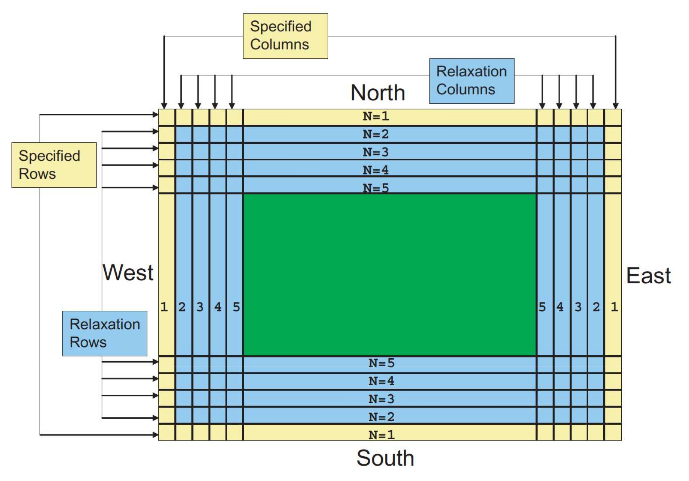

 .. role:: cpp(code)
    :language: c++

.. _sec:LateralBoundaryConditions:

Domain Boundary Condition Types
~~~~~~~~~~~~~~~~~~~~~~~~~~~~~~~~~~~~~~~~~~~~~~~~~~~

Lateral boundary conditions in ERF can be specified for idealized simulations as periodic, inflow, outflow, or open. More realistic conditions include the use of time-varying values read in from external files, such as the wrfbdy files generated by the WRF Preprocessing System (WPS).
ERF also has the option to run precursor simulations, save planes of data at specified times, and later read boundary data from those files analogously to how data from the wrfbdy are used.

The bottom surface boundary condition can be specified as a simple wall or by using Monin-Obukhov similarity theory (MOST).
When utilizing MOST, the surface roughness, :math:`z_0`, may be specified as a constant, read from a file,
or dynamically computed from the Charnock or shallow water formulation.
Time-varying sea surface temperatures may also be employed in conjunction with MOST.

Ideal Domain BCs
----------------------

There are two primary types of physical/domain boundary conditions: those which rely only on the
data in the valid regions, and those which rely on externally specified values.

ERF allows users to specify types of boundary condition with keywords in the inputs file.
The information for each face is preceded by
``xlo``, ``xhi``, ``ylo``, ``yhi``, ``zlo``, or ``zhi``.

Currently available type of boundary conditions are
``inflow``, ``outflow``, ``inflow_outflow``, ``slipwall``, ``noslipwall``, ``symmetry`` or ``surface_layer``.
(Spelling of the type matters; capitalization does not.)

For example, setting

::

    xlo.type = "inflow"
    xhi.type = "outflow"
    zlo.type = "slipwall"
    zhi.type = "slipwall"

    geometry.is_periodic = 0 1 0

would define a problem with inflow in the low-\ :math:`x` direction,
outflow in the high-\ :math:`x` direction, periodic in the :math:`y`-direction,
and slip wall on the low and high :math:`y`-faces, and
Note that no keyword is needed for a periodic boundary, here only the
specification in ``geometry.is_periodic`` is needed.

Each of these types of physical boundary condition has a mapping to a mathematical boundary condition
for each type; this is summarized in the table below.

.. _sec:dirichlet:

ERF provides the ability to specify a variety of boundary conditions (BCs) in the inputs file.
We use the following options preceded by ``xlo``, ``xhi``, ``ylo``, ``yhi``, ``zlo``, and ``zhi``:

+-----------------+----------------+------------------+------------------------------+---------------------------------------------+-----------------+
| Type            | Normal vel     | Tangential vel   | Density                      | Theta                                       | Scalar          |
+=================+================+==================+==============================+=============================================+=================+
| inflow          | ext_dir        | ext_dir          | ext_dir                      | ext_dir                                     | ext_dir         |
+-----------------+----------------+------------------+------------------------------+---------------------------------------------+-----------------+
| outflow         | foextrap       | foextrap         | foextrap                     | foextrap                                    | foextrap        |
+-----------------+----------------+------------------+------------------------------+---------------------------------------------+-----------------+
| inflowoutflow   | ext_dir if     | ext_dir if       | ext_dir if                   | ext_dir if                                  | ext_dir if      |
|                 | inflowing;     | inflowing;       | inflowing;                   | inflowing;                                  | inflowing;      |
|                 | otherwise      | otherwise        | otherwise                    | otherwise                                   | otherwise       |
|                 | foextrap       | foextrap         | foextrap                     | foextrap                                    | foextrap        |
+-----------------+----------------+------------------+------------------------------+---------------------------------------------+-----------------+
| slipwall        | ext_dir        | foextrap         | ext_dir / foextrap / neumann | ext_dir / ext_dir_prim / foextrap / neumann | foextrap        |
+-----------------+----------------+------------------+------------------------------+---------------------------------------------+-----------------+
| noslipwall      | ext_dir        | ext_dir          | ext_dir / foextrap           | ext_dir / ext_dir_prim / foextrap / neumann | foextrap        |
+-----------------+----------------+------------------+------------------------------+---------------------------------------------+-----------------+
| symmetry        | reflect_odd    | reflect_even     | reflect_even                 | reflect_even                                | reflect_even    |
+-----------------+----------------+------------------+------------------------------+---------------------------------------------+-----------------+
| surface_layer   | ext_dir        | hoextrap         | hoextrap                     | hoextrap                                    | hoextrap        |
+-----------------+----------------+------------------+------------------------------+---------------------------------------------+-----------------+

Here ``ext_dir``, ``foextrap``, and ``reflect_even`` refer to AMReX keywords.   The ``ext_dir`` type
refers to an "external Dirichlet" boundary, which means the values must be specified by the user.
The ``foextrap`` type refers to "first order extrapolation" which sets all the ghost values to the
same value in the last valid cell/face. By contrast, ``hoextrap``, or "higher order extrapolation",
does a linear extrapolation from the two nearest valid values. The ``neumann`` condition is an
ERF-specific boundary type for a specified variable gradient. It is supported for theta on
``slipwall`` and ``noslipwall`` faces and for density on compressible ``slipwall`` faces.
On a terrain-fitted mesh, a scalar with ``foextrap`` at the bottom or top of the domain diffuses
nothing through that face: the condition is taken as zero flux along the face normal, which on
sloping terrain is not the same as a zero vertical gradient. The
``surface_layer`` condition is an ERF-specific
boundary type that employs the above set of boundary conditions but also directly specifies the
subgrid scale diffusive fluxes; see :ref:`sec:surface_layer` for more information.

As an example,

::

    xlo.type                =   inflow
    xlo.velocity            =   1. 0.9  0.
    xlo.density             =   1.
    xlo.theta               =   300.
    xlo.scalar              =   2.

sets the boundary condition type at the low x face to be an inflow with xlo.type = “inflow”.

xlo.velocity = 1. 0. 0. sets all three componentns the inflow velocity,
xlo.density       = 1. sets the inflow density,
xlo.theta         = 300. sets the inflow potential temperature,
xlo.scalar        = 2. sets the inflow value of the advected scalar

Non-reflecting inflow
^^^^^^^^^^^^^^^^^^^^^

By default, the ``inflow`` boundary prescribes Dirichlet values for all variables
including :math:`\rho\theta`, which implicitly fixes the pressure in the ghost cells.
This causes upstream-propagating acoustic waves to reflect off the boundary,
which can destabilize simulations with terrain or other pressure perturbation sources.

Setting ``nonreflecting = true`` on an inflow face switches the :math:`\rho\theta`
boundary condition from ``ext_dir`` to ``foextrap`` (zero-gradient extrapolation from
the interior) while keeping velocity and density prescribed. This allows the outgoing
acoustic characteristic (pressure) to exit the domain.

::

    xlo.type            = “Inflow”
    xlo.velocity        = 10. 0. 0.
    xlo.density         = 1.16
    xlo.theta           = 300.
    xlo.nonreflecting   = true

Additionally, one may use an input file to specify the Dirichlet velocities as a function of the
vertical coordinate z. The input file is expected to contain either ``{z  u  v  w}`` or
``{z  u  v  w  theta}`` and is currently only available for the ``xlo`` face. For a file
named ``inflow_file`` that contains the variables ``{z  u  v  w}``, one would use
the inputs below; note, that if the inflow file contains ``{z  u  v  w  theta}`` then the
below example should be modified to ``not`` include ``xlo.theta = <val>``.
If ``theta`` is provided, it is by default the primitive variable, not the conserved quantity
rho*theta. To specify rho*theta instead, ``xlo.read_prim_theta = false`` should be set.
A primitive ``theta`` is converted to rho*theta with the density the face prescribes
(``xlo.density``), or with the first interior cell's density when no density is given, on
``inflow`` and ``inflow_outflow`` faces alike, so the inflow potential temperature the
scheme sees is the file's value whatever the density ratio between the inflow and the
interior. The file's theta applies only to the face that names the file; other inflow
faces use their own ``theta``.

::

    xlo.type                =   "inflow"
    xlo.dirichlet_file      =   "inflow_file"
    xlo.density             =   1.
    xlo.theta               =   300.
    xlo.scalar              =   2.

.. _sec:inflow-profiles:

Terrain-following inflow profiles
^^^^^^^^^^^^^^^^^^^^^^^^^^^^^^^^^

On a terrain-fitted mesh the ground along an inflow face need not be level.
``<face>.inflow_profile`` imposes a vertical profile of the wind, and of theta
and tke where given, as a function of the height above the local ground: every
boundary cell takes the profile at its own height above the terrain beneath it.
The inflow therefore follows the terrain along the face and the terrain stays on
the boundary, as WindNinja's inlets do; ``dirichlet_file`` instead holds one
value per grid level along the whole face. The option applies to ``inflow`` and
``inflow_outflow`` faces; on an ``inflow_outflow`` face only the cells where the
flow enters take the profile. Density is extrapolated from the interior and the
vertical velocity keeps its boundary value.

``<face>.inflow_profile = log_law`` tabulates the neutral log law

.. math::

   u(z) = \frac{u_*}{\kappa} \ln\frac{z + z_0}{z_0}, \qquad
   u_* = \frac{\kappa\, U}{\ln\left((z_{ref} + z_0)/z_0\right)},

with :math:`z` the height above the ground, and prescribes tke
:math:`= u_*^2/C_{\mu 0}^2` at the ground (the value ``erf.dirichlet_k`` holds in
the first cell), tapering linearly to zero at ``tke_zscale`` :math:`u_*` with the
floor used by ``erf.init_tke_from_ustar``. All inflow faces with ``log_law``
share these parameters:

.. list-table::
   :header-rows: 1

   * - Parameter
     - Description
     - Default
   * - ``inflow_log_law.speed``
     - wind speed :math:`U` at ``height`` [m/s]
     - required
   * - ``inflow_log_law.height``
     - reference height :math:`z_{ref}` above the ground [m]
     - 10
   * - ``inflow_log_law.direction``
     - direction the wind blows from [degrees, meteorological]
     - 270
   * - ``inflow_log_law.z0``
     - roughness length [m]
     - ``erf.most.z0``, else 0.1
   * - ``inflow_log_law.max_speed``
     - cap on the speed [m/s]; zero or negative means none
     - none
   * - ``inflow_log_law.tke_zscale``
     - depth of the tke taper in units of :math:`u_*` [s]
     - 700

``<face>.inflow_profile = file`` reads ``<face>.inflow_profile_file``, a table
in the layout of kynema-sgf's ``TabulatedProfile``: one row per height above the
ground, heights strictly increasing. A comment line whose first word is ``z``
names the columns (``z u v w T tke`` in any order; ``theta`` and ``k`` are
accepted for ``T`` and ``tke``); other comment lines are ignored. Without such a
header, four columns are ``z u v T`` and five are ``z u v T tke``. A ``w``
column is read and not used. Theta and tke are prescribed only when their
columns are present; otherwise they are extrapolated from the interior.

::

    xlo.type                 = "Inflow"
    xlo.inflow_profile       = "log_law"
    inflow_log_law.speed     = 20.0     # m/s at 10 m above the ground
    inflow_log_law.direction = 285.0    # the wind blows from 285 degrees
    inflow_log_law.max_speed = 35.0

    yhi.type                 = "Inflow"
    yhi.inflow_profile       = "file"
    yhi.inflow_profile_file  = "profile.txt"

To start the interior consistently, ``erf.input_sounding_wind_above_ground = true``
interpolates the input sounding's winds at the height above the local ground, and
``erf.input_sounding_theta_above_ground = true`` does the same for theta, which a
profile file with a ``T`` column also applies above the ground: a capping inversion
then follows the terrain in the interior as it does on the inflow faces. The
pressure keeps the sounding's value at the physical height, the density follows
from it, and each column is rebalanced hydrostatically with the shifted theta.
Both flags default to false. On a terrain-fitted mesh started from an input
sounding, ERF prints a warning at start-up when an inflow profile is set and the
wind flag is off, or when the profile has a ``T`` column and the theta flag is off.
``Exec/CanonicalTests/Canonical_RANS/Terrain_Inflow_Profile`` exercises the
option over a raised plateau, an inclined and a declining slope, and a ridge
across the inflow face, and the theta flag with a capping inversion over the
incline.

Scalar values at solid walls
^^^^^^^^^^^^^^^^^^^^^^^^^^^^

Solid-wall scalar inputs are independent on each physical face. A value or
gradient is interpreted using the density policy on that same face; inputs on
one face do not change another face. Presence is explicit, so a numerical zero
is a valid input. Fixed wall values are specified at the physical wall face,
including for cell-centered state data.

For both ``slipwall`` and ``noslipwall`` faces, ``theta`` and ``theta_grad``
are supported and are mutually exclusive. On ``noslipwall`` faces, primitive
``qv`` is also supported; ``qv = 0.0`` requests an explicitly dry wall.
Supported wall inputs are specified in primitive form. On compressible
``slipwall`` and ``noslipwall`` faces, same-face ``density`` may
be supplied so ERF stores the corresponding conserved value. ``density_grad``
is supported only on compressible ``slipwall`` faces; supplying it on a
``noslipwall`` face is an input error. Anelastic solid walls must omit both
``density`` and ``density_grad``.

For every supported variable, a fixed value and its corresponding gradient on
the same face are mutually exclusive.

When same-face density is omitted, a specified ``theta`` or ``qv`` remains a
primitive wall value. Omitting both ``theta`` and ``theta_grad`` gives an
adiabatic, extrapolated theta boundary. A specified gradient uses the
coordinate direction of the face keyword.

For example

::

    zlo.type  = "NoSlipWall"
    zhi.type  = "NoSlipWall"

    zlo.theta = 301.0

would designate theta = 301 at the bottom (zlo) boundary, while
the top boundary condition would default to a zero gradient (adiabatic)
since no value is specified for ``zhi.theta`` or ``zhi.theta_grad``.
By contrast, thermal inversion may be imposed at the top boundary
by providing a specified gradient for theta

::

    zlo.type  = "NoSlipWall"
    zhi.type  = "NoSlipWall"

    zlo.theta = 301.0
    zhi.theta_grad = 1.0

We note that ``noslipwall`` allows for non-zero tangential velocities to be specified, as in the
Couette regression test example, in which we specify

::

    geometry.is_periodic = 1 1 0

    zlo.type = "NoSlipWall"
    zhi.type = "NoSlipWall"

    zlo.velocity    = 0.0 0.0 0.0
    zhi.velocity    = 2.0 0.0 0.0

Density may be prescribed at a solid wall in the same two ways as potential
temperature: ``<face>.density`` sets a Dirichlet value and ``<face>.density_grad``
sets a Neumann gradient.  Only one of the two may be given on a face, and neither
is accepted for an anelastic run, where the density is not a free variable.

For a ``noslipwall`` face in a simulation with an active moisture model, the
water-vapor mixing ratio may likewise be prescribed with ``<face>.qv``.  It is
not read for ``slipwall`` faces.

We also note that in the case of a ``slipwall`` boundary condition in a simulation with non-zero
viscosity specified, the "foextrap" boundary condition enforces zero strain at the wall.

Real Domain BCs
----------------------

When using real lateral boundary conditions, time-dependent observation data is read
from a file. In ERF, the observation (BDY) data is utilized to nudge the solution state towards
the observation data in the interior of the domain. We explicitly note that the wall normal
velocity on a domain boundary are set to the observational data and the RHS for these points
is assigned the BDY tendency. The user may specify (in the inputs file) the total
width of the interior boundary region with ``erf.real_width = <Int>`` (yellow + blue).
The real BCs are only imposed for :math:`\psi = \left\{ \theta; \; q_v; \; u; \; v \right\}`
by default, and for :math:`\rho` as well with ``WRFInput`` boundaries (below).
In the lateral ghost cells, the density when it is not read, the passive
scalars and the turbulent kinetic energy are extrapolated from the interior with
zero gradient, and the moisture components other than :math:`q_v`
(cloud and precipitating hydrometeors) are set to zero; hydrometeors are
neither read from ``wrfbdy`` nor nudged toward WRF values. For compressible ``WRFInput`` boundaries,
``erf.use_wrf_bdy_density`` (true by default) uses the converted WRF dry-air
density as the target for ``rho``, ``rho*theta``, and ``rho*qv`` and relaxes
``rho`` in the Davies zone. Pressure is still diagnosed from the ERF equation
of state rather than directly nudged. This option is not supported for
MetGrid-only boundaries, generic boundary-plane input, or anelastic runs.

.. _fig:lateral_BCs:

.. table:: Lateral boundaries

   +-----------------------------------------------------+
   |                     |wrfbdy|                        |
   +-----------------------------------------------------+
   |  Image taken from `Skamarock et al. (2021)`_        |
   +-----------------------------------------------------+

.. _`Skamarock et al. (2021)`: http://dx.doi.org/10.5065/1dfh-6p97

To nudge the state data towards the observation data, we add a source term (:math:`G`) to the RHS (:math:`F`)
of the governing equations:

.. math::

   \begin{align}
   G &= \frac{1}{A \Delta t} \xi^{2} \left( \psi^{BDY} - \psi^{*} \right),
   \end{align}

where :math:`A` is specified with ``erf.bdy_nudge_factor`` (defaults to 10.0),
:math:`\psi^{*}` is the state variable at the current RK stage, :math:`\psi^{BDY}` is
the temporal interpolation of the observational data, and :math:`\xi` is a linear coordinate
that is 1 at the domain boundary and 0 at the edge of the nudge region.

For turbulent inflow perturbations, including the ``erf.perturbation_type`` options and
their placement on level subdomains, see :doc:`InflowTurbulenceGeneration`.

ERF Boundary Data Files
-----------------------

For real lateral boundary conditions, ``init_type`` of ``metgrid`` or ``wrfinput``, ERF can
write lateral boundary data to an AMReX-native file during initialization. The file name is
configurable with ``erf.erfbdy_file`` (default ``"erfbdy"``).

Use of the erfbdy file is mandatory for ``init_type`` of ``metgrid``, which is why
``erf.write_erfbdy`` defaults to true there.

For ``init_type`` of ``wrfinput`` the boundary data are read from the ``erf.nc_bdy_file``
named in the inputs file as they are needed during time integration, and an erfbdy file is
neither written nor read unless it is asked for: set ``erf.write_erfbdy = true`` to write
one during initialization, and ``erf.use_erfbdy = true`` on a later run to read the boundary
data from it rather than from ``erf.nc_bdy_file``.

An erfbdy file records the domain it was built for, and ERF aborts if that does not match
the domain of the run reading it. ERF does not, however, verify which wrfbdy file the
boundary data came from, so an erfbdy file must be rewritten if ``erf.nc_bdy_file`` changes.
