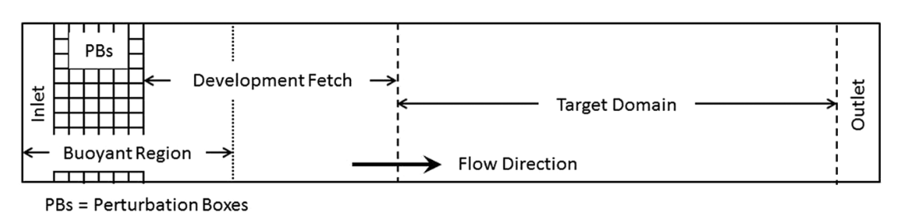

.. _sec:InflowTurbulenceGeneration:

Inflow Turbulence Generation
~~~~~~~~~~~~~~~~~~~~~~~~~~~~

ERF provides the capability to apply a perturbation zone at the inflow boundary to
mechanically trip turbulence within the domain. The current version of the turbulence
generation techniques allows for ``x`` and ``y`` (horizontal) direction perturbations.
In Figure 2, as the bulk flow passes through the buoyant region, it becomes perturbed.
This perturbation, combined with a short development fetch, quickly leads to the
evolution of turbulence.

.. _fig:pb_fig:

.. table:: Box perturbation method

   +-----------------------------------------------------+
   |                     |PBinflw|                       |
   +-----------------------------------------------------+
   |  Image taken from `DeLeon et al. (2018)`            |
   +-----------------------------------------------------+

Four different types of perturbation methods are currently available,
``source``, ``direct``, ``CPM``, and ``CPM_W``. The first two methods use the formulation
introduced by `DeLeon et al. (2018)`_ and are referred to as the box perturbation
method. The ``source`` option applies the perturbation amplitude range,
:math:`\pm \Phi_{PB}`, to each cell within the perturbation box as a source term.
The ``direct`` option uses the same rate but adds it, multiplied by the time step,
directly to the :math:`\rho \theta` field at the start of every time step. Both
options add the same total perturbation over one update interval. The following
describes the theory of the box perturbation method:

.. _`DeLeon et al. (2018)`: https://doi.org/10.2514/1.J057245

The perturbation update interval of the individual perturbation box is determined by,

.. math::

   \frac{t_p \langle U(z) \rangle_{PB}}{D_{PB}} = 1,

The change in the perturbation amplitude is defined as,

.. math::

   {Ri}_{PB} = \frac{g \beta \Delta \overline{\phi} H_{PB}}{{\langle U(z) \rangle}^2_{PB}}.

The current implementation supports lateral boundary perturbations, specified by
``erf.perturbation_direction``, where the six integer inputs represent perturbations
applied at the west, south, bottom, east, north, and top faces, respectively.
Note that while the top and bottom options are included, triggering either option
will abort the program.

At level 0, the perturbation boxes are placed inward from the corresponding domain
face. On refined levels, ERF places perturbation boxes inward from the corresponding
face of each subdomain on that level. In other words, each subdomain at a level is
treated as its own local rectangular "domain" for the purpose of positioning
perturbation boxes.

The current implementation assumes that every subdomain on a level where perturbations
are enabled is rectangular and completely covered by grids at that level. If
perturbations are requested on a level and any subdomain on that level is not
rectangular, ERF will abort with an error.

In addition to the direction of perturbation, the flow perturbation method requires
the dimensions of an individual box, specified through ``erf.perturbation_box_dims``,
with three integer inputs representing :math:`{Nx}_{pb}`, :math:`{Ny}_{pb}`, and
:math:`{Nz}_{pb}`, respectively. Following the guidance of `Ma and Senocak (2023)`_,
the general rule of thumb is to use :math:`H_{PB} = 1/8 \delta` as the height of
the perturbation box, where :math:`\delta` is the boundary layer height. The length
of the box in the x-direction should be :math:`L_{PB} = 2H_{PB}`. Depending on the
direction of the bulk flow, the width of the box in the y-direction should be
defined as :math:`W_{PB} = L_{PB} \tan{(\theta_{inflow})}`. The current
implementation only accepts integer entries. Therefore, considering the domain size
and mesh resolution, the dimensions of a single box can be determined.

.. _`Ma and Senocak (2023)`: https://link.springer.com/article/10.1007/s10546-023-00786-1

The perturbation mode is selected with ``erf.perturbation_type``. This input may be
specified either once for all levels or once per level, following the same
convention used by ``erf.les_type``. For example, in a two-level run,

::

          erf.perturbation_type = None source

disables perturbations on level 0 and enables ``source`` perturbations on level 1.
The remaining perturbation inputs shown below are currently shared by all active
perturbation levels.

Specification of the number of layers and the offset into the domain or subdomain
of the perturbation boxes can be made through ``erf.perturbation_layers`` and
``erf.perturbation_offset``, respectively. Below is an example of the required
input tags to set up a simulation with inflow perturbations.

::

          erf.perturbation_type = "source"

          erf.perturbation_direction = 1 0 0 0 0 0
          erf.perturbation_box_dims = 8 8 4
          erf.perturbation_layers = 3
          erf.perturbation_offset = 5

          erf.perturbation_nondimensional = 0.042
          erf.perturbation_T_infinity = 300.0
          #erf.perturbation_T_intensity = 0.1

The ``erf.perturbation_T_intensity`` tag can be turned on or off by providing a
value or commenting it out. When a value is provided (recommended 0.1-0.25 max),
a pseudo-gravity value is used (solved from the Richardson formulation) to
normalize the scales of the problem, and is represented as,

.. math::

   g = \frac{{Ri}_{PB} {\langle U(z) \rangle}^2_{PB}}{\beta \Delta \phi H_{pb}}.

Using this pseudo-gravity value effectively negates the Richardson number
formulation, and the temperature gradient becomes,

.. math::

   \Delta \phi = T_{i} T_{\infty},

where :math:`T_{i}` is the temperature intensity, and :math:`T_{\infty}` is the
background temperature.

While this generates quick turbulence, it should be used as a sanity check rather
than a runtime strategy for turbulence generation, therefore it is not recommended.
Additionally, a net-zero energy enforcement is applied over the perturbation boxes
to ensure that the synthetic method does not introduce excess energy into the system
at each iteration. Below, we provide a detailed description of the two different
types of perturbation methods currently existing within ERF.

Examples are provided within ``Exec/RegTests/TurbulentInflow/`` to set up a
turbulent open channel flow using inflow/outflow boundary conditions with the
aforementioned turbulent inflow generation technique to trigger turbulence
downstream.

Source type forcing
-------------------

By ignoring the advection and diffusion effects in the transport equation, the
amplitude of the perturbation can be made through a proportionality ratio between
the update time and change in the box temperature,

.. math::

   \Phi_{PB} \propto \frac{\Delta \overline{\phi}}{t_p}

and the perturbation amplitude is then computed through,

.. math::

   \Phi_{PB} = \frac{Ri_{PB} {\langle U(z) \rangle}^2_{PB}}{g \beta D_{PB} H_{PB}}.

``source`` type forcing can adopt the box perturbation method by having the
following inputs list.

::

          erf.perturbation_type = "source"

          erf.perturbation_direction = 1 0 0 0 0 0
          erf.perturbation_box_dims = 8 8 4
          erf.perturbation_layers = 3
          erf.perturbation_offset = 5

          erf.perturbation_nondimensional = 0.042 # Ri
          erf.perturbation_T_infinity = 300.0

The box perturbation method (BPM) perturbs the temperature field :math:`\rho \theta`
in a volume (box) format. Each box computes a perturbation update time and
amplitude, then independently updates at its respective update interval during
runtime. A single perturbation amplitude is seen by the computational cells that
fall within this box. A pseudo-random perturbation (that is, white noise) is
applied over the range :math:`[-\phi, +\phi]` then introduced to the
:math:`\rho \theta` field via source term (:math:`F_{\rho \theta}`). As temperature
is transported and through the action of the subgrid-scale (SGS) filter for eddy
viscosity, white-noise temperature perturbations become colored noise in the
velocity field. Since the perturbation enters only as a source term, none is
added to the initial state; the forcing starts with the first time step.

The perturbations do not depend on the domain decomposition, for every
``erf.perturbation_type``. A perturbation box's mean velocity, update interval and
net-zero correction (and, for ``CPM``, its single random value) are computed over
the whole box, whichever grid boxes and MPI ranks it spans. The random values are
hashed from the global cell index (or, where there is one value per box, the box
index) and the number of times the box has been updated. The seed is 1024 with
``erf.fix_random_seed = 1``, otherwise ``erf.random_seed`` if it is given, and 0
otherwise, so a run is repeatable unless the seed is changed.

Turbulence onset can be triggered by adjusting the size of the perturbation box,
as the amplitude is heavily influenced by having the two-dimensional scales of the
perturbation box in the denominator.

Direct type forcing
-------------------

The ``direct`` method computes the same amplitude and update interval as the
``source`` method, and differs only in how the perturbation is added. Instead of
entering the right-hand side as a source term, the perturbation is added to the
:math:`\rho \theta` field before each time step as

.. math::

   (\rho \theta)^n \leftarrow (\rho \theta)^n + \Delta t \, \Phi_{PB},

where :math:`\Delta t` is the current time step of the level. Since the increment
is scaled by the current time step, a box receives a total of
:math:`\Delta \overline{\phi}` over one update interval :math:`t_p` even when the
time step varies. As for the ``source`` method, no perturbation is added at the
initial time.

To activate the ``direct`` type forcing, set the following inputs list.

::

          erf.perturbation_type = "direct"

          erf.perturbation_direction = 1 0 0 0 0 0
          erf.perturbation_box_dims = 16 16 8
          erf.perturbation_layers = 3
          erf.perturbation_offset = 5

          erf.perturbation_nondimensional = 0.042 # Ri
          erf.perturbation_T_infinity = 300.0

Cell Perturbation Method
------------------------

The cell perturbation method (CPM) is an implementation of the CPM that is available
in WRF (
`Muñoz-Esparza et al. (2014) <https://doi.org/10.1007/s10546-014-9956-9>`_,
`Muñoz-Esparza et al. (2015) <https://doi.org/10.1063/1.4913572>`_,
`Muñoz-Esparza and Kosović (2018) <https://journals.ametsoc.org/view/journals/mwre/146/6/mwr-d-18-0077.1.xml>`_ ).
The numerical implementation is similar to the box perturbation method described
above with a few notable differences. Most notably there are no white-noise
perturbations within each box/cell. Instead, the stochastic amplitude is applied to
all nodes within a box/cell. The perturbation amplitude is formulated as follows:

.. math::

   \Phi_{PB} = \frac{U_g^2}{c_p Ec},

where :math:`U_g` is the geostrophic wind speed and :math:`Ec` is the Eckert
number. The geostrophic wind speed can be considered the large-scale forcing.
In manual mode, this value is prescribed by the user (``erf.perturbation_Ug``) and
should represent the wind speed above the boundary layer and in the free
atmosphere. Automatic mode instead samples the horizontal wind at 1.1 times the
edge-mean PBL height on a coarser level, as described below. Previous research
has shown the optimum Eckert number to be 0.2 to
quickly develop turbulence (`Muñoz-Esparza and Kosović (2018) <https://journals.ametsoc.org/view/journals/mwre/146/6/mwr-d-18-0077.1.xml>`_).

The perturbation update interval depends on the advective time scale for flow
through the perturbation boxes/cells:

.. math::

   t_p = \frac{L_{PB} \cdot \text{num_layers}}{\cos{\left(\langle \theta(z) \rangle_{PB} \right)} \langle U(z) \rangle_{PB}},

where :math:`\langle \theta(z) \rangle_{PB}` is the local wind direction and
:math:`\langle U(z) \rangle_{PB}` is the local wind speed of the box/cell.

Below is an example of the input tags necessary for a simulation with CPM:

::

          erf.perturbation_type = "CPM"

          erf.perturbation_direction = 1 0 0 0 0 0
          erf.perturbation_box_dims = 8 8 3
          erf.perturbation_layers = 3
          erf.perturbation_offset = 5

          erf.perturbation_Ug = 10.0

          erf.perturbation_klo = 1
          erf.perturbation_khi = 40

Best practices are to set :math:`{Nx}_{pb}=8`, :math:`{Ny}_{pb}=8`, and
:math:`{Nz}_{pb}=3` regardless of the physical size of the boxes/cells and to set
``erf.perturbation_layers = 3``. The user can also specify the vertical extent of
the perturbation region using ``erf.perturbation_klo`` and ``erf.perturbation_khi``.
For example, if the user would like to only perturb the atmospheric boundary layer up
to a specified inversion height, they can use ``erf.perturbation_khi`` to limit how
high the perturbations extend. Best practice is to specify ``erf.perturbation_klo = 1``
to prevent any unphysical interactions with the bottom boundary conditions. If the user
does not specify the perturbation extents, the perturbation region will extend the entire
vertical column.

An example using CPM with a stable atmospheric boundary layer inflow setup is
available in ``Exec/RegTests/TurbulentInflow/``.

A modified version of CPM is also available where the user can specify vertical velocity perturbations.
This pathway can be specified using ``erf.perturbation_type = "CPM_W"``. The user can specify the range
for the vertical velocity perturbations using ``erf.perturbation_w_amp``. For example, if the user
specifies ``erf.perturbation_w_amp = 1.0``, the range of the vertical velocity perturbations will be
[-1, 1].

Below is an example of the input tags to utilize the vertical velocity perturbation modification of CPM
with an example also in ``Exec/RegTests/TurbulentInflow/``:

::

          erf.perturbation_type = "CPM_W"

          erf.perturbation_direction = 1 0 0 0 0 0
          erf.perturbation_box_dims = 8 8 3
          erf.perturbation_layers = 3
          erf.perturbation_offset = 5

          erf.perturbation_w_amp = 1.5

          erf.perturbation_klo = 1
          erf.perturbation_khi = 40

Automatic perturbations on LES nests
-----------------------------------

Set ``erf.perturbation_auto = true`` to obtain the active inflow edges and
advective wind scale from each nest's immediate parent, and the height limit
from its finest ancestor using a PBL scheme. This defaults
to ``true`` for ``erf.init_type = WRFInput`` or ``Metgrid`` and ``false`` for
other initialization types. An explicit ``erf.perturbation_auto = false``
retains the manual controls described above. This option works with ``source``,
``direct``, ``CPM`` and ``CPM_W``. A perturbation method must still be selected
with ``erf.perturbation_type``; its default remains ``None``.

In automatic mode, ERF enables the requested perturbation type only on refined
levels using a three-dimensional LES closure (Smagorinsky or Deardorff) without
a PBL scheme. Level 0, PBL levels, RANS levels and Smagorinsky2D levels receive
no perturbations. An explicit ``None`` in the per-level perturbation-type list
still disables that level. The immediate parent may use a PBL scheme or be
another LES level. For the PBL height, ERF searches from that parent toward
level 0 and selects the first level with a PBL scheme. For example, with a
PBL scheme on level 0 and LES on levels 1 and 2, both LES levels use level 0's
PBL height; level 1 samples level 0's winds, while level 2 samples level 1's
winds. If levels 0 and 1 both use PBL schemes, an LES level 2 instead uses
level 1's PBL height. Automatic mode requires a PBL ancestor with a valid
height diagnostic; it does not substitute a diagnostic from an LES level.

For example, add the following to a two-level case with a YSU parent and a
Deardorff nest. The case must also have the surface-layer inputs required by its
PBL scheme::

          erf.les_type = None Deardorff
          erf.pbl_type = YSU None
          erf.perturbation_type = CPM
          erf.perturbation_auto = true
          erf.perturbation_auto_period = 600.0
          erf.perturbation_auto_pbl_fraction = 0.9

          erf.perturbation_box_dims = 8 8 3
          erf.perturbation_layers = 3
          erf.perturbation_offset = 5

The automatic controls are:

.. list-table:: Automatic perturbation inputs
   :header-rows: 1
   :widths: 42 12 46

   * - Input
     - Default
     - Meaning
   * - ``erf.perturbation_auto``
     - Depends on initialization
     - Enable parent controls on eligible LES nests; defaults to ``true`` for WRFInput and Metgrid, ``false`` otherwise.
   * - ``erf.perturbation_auto_period``
     - ``600.0``
     - Seconds between updates of edges, height and wind scale; must be positive.
   * - ``erf.perturbation_auto_pbl_fraction``
     - ``0.9``
     - Fraction of the finest PBL ancestor's height; must be greater than zero and at most one.

At the first advance of a nest, ERF samples the latest available parent state.
For each lateral edge of each rectangular subdomain, it samples one parent
column in width along that edge. Each parent column uses the PBL height of the
cell containing it on the selected PBL ancestor. This mapping uses the cumulative
horizontal refinement ratio and retains the ancestor's height in metres AGL.
It averages the horizontal wind components over the lower
``perturbation_auto_pbl_fraction`` of that height, weighting
by the vertical cell thickness inside that layer. If the parent grids end
below that height, the wind average uses the available part of the layer.
Wind components are in the simulation's grid directions. A positive mean
``u`` selects the west edge and a negative mean ``u`` selects the east edge;
positive and negative mean ``v`` select the south and north edges, respectively.
Each edge uses its own average, so opposing edges can both be active if the
parent winds vary spatially. Periodic physical edges, walls and symmetry faces
are excluded. Internal coarse/fine edges remain eligible.

The height cutoff for an edge is the specified fraction of the ancestor PBL
height averaged over the sampled parent columns: by default, 90% of this edge
mean. Each column contributes once to the arithmetic mean. This produces one
uniform cutoff in metres AGL along each edge and throughout its perturbation
layers; it does not vary with the PBL height at individual columns. Different
edges may have different means. Perturbations are applied only where the sample
point lies above local ground and at or below this cutoff: cell centers for thermal perturbations and
vertical-velocity faces for ``CPM_W``. Thus the cutoff follows the nest's local
terrain and can cut through a perturbation box. Shared corners receive one
increment; they are active if either adjoining edge permits perturbations.
Where a box intersects two active edges, the larger lower-PBL wind speed sets
its refresh interval and its ``source``/``direct`` amplitude. For ``CPM``, the
larger above-PBL wind scale sets its amplitude.

For ``CPM``, ERF obtains ``Ug`` by sampling horizontal wind at **1.1 times the
edge-mean PBL height**, in metres AGL. It first tries the immediate parent and
then successively coarser levels, choosing the finest ancestor whose grids
cover that height in every sampled column along the edge. The PBL height still
comes from the finest ancestor with a PBL scheme. If no coarser level covers
the target height, automatic CPM stops with an error.

On the selected level, ERF linearly interpolates cell-centred ``u`` and ``v``
to the target height in each column, averages each component along the edge,
and sets ``Ug = sqrt(mean(u)^2 + mean(v)^2)``. It uses the nearest cell centre
within the bottom or top half-cell, and never extrapolates outside the
available grid. This above-PBL wind estimate replaces ``perturbation_Ug`` in
the CPM amplitude formula. It is independent of the lower-PBL wind used for
inflow selection and advective refresh timing. ``source`` and ``direct`` retain
the lower-PBL parent wind for their existing amplitude and refresh formulas.
``CPM_W`` retains ``perturbation_w_amp`` for its vertical-velocity amplitude.

The controls are recomputed on the first nest time step at or after the update
period has elapsed since the previous control update (600 seconds by default).
The individual perturbation boxes continue to draw new random values on their
existing advective intervals between these updates. At a control update, ERF
clears the previous forcing and regenerates it under the new controls. Calm
edges are disabled and can become active at a later update. This clears stored
forcing; perturbations already advected into the solution continue to evolve.

``perturbation_box_dims``, ``perturbation_layers`` and ``perturbation_offset``
remain required. Layers must be positive, and the offset must leave space
inside the nest. Dimensions and offsets are specified in cells at each level.
``perturbation_direction``, ``perturbation_Ug``, ``perturbation_klo`` and
``perturbation_khi`` do not control the automatic regions. Thermal perturbations
may include the lowest cell center; ``CPM_W`` excludes the ground face.

The selected PBL ancestor's height comes from its bottom ``surface_layer``
diagnostic, or from native SHOC's PBL-height diagnostic. When the bottom surface
layer has no explicit ``most.pblh_calc`` input, automatic mode supplies
``MYNN25``. In automatic mode the MYNN diagnostic
uses heights above local ground, including its near-surface temperature scan
and TKE blending. YSU, YSUNew and MRF write their scheme's height to the surface
layer as they advance. An explicit ``most.pblh_calc`` setting is respected in
the bottom face's input namespace; it must provide a valid height on the
selected PBL ancestor. A diagnosed height of zero contributes zero to the edge
mean and provides no depth for the wind average. Missing or uninitialized
heights cause an error when the controls are updated.

Automatic mode currently supports rectangular nests that reach the ground, on
flat, stretched or fitted-terrain meshes. Immersed-forcing terrain and embedded
boundary terrain are not supported. The finest cells and their parent cells
need not have the same vertical spacing or domain height. Regridding, delayed
nest creation and restarting reset the control timer and recompute the controls
at the next advance; random refresh counters are not checkpointed, so a restart
does not reproduce an uninterrupted random sequence.

Set ``erf.v = 1`` to log each control update's time, wind-parent level
(``parent``), PBL-height source level (``pbl_level``), edge, inflow selection,
mean wind and height cutoff in metres AGL.
For ``CPM``, the log also reports the wind source level (``Ug_level``), target
height (``Ug_height_agl``), and sampled speed (``Ug``). An inactive edge has
``Ug_level = -1`` because it does not need an amplitude sample.
