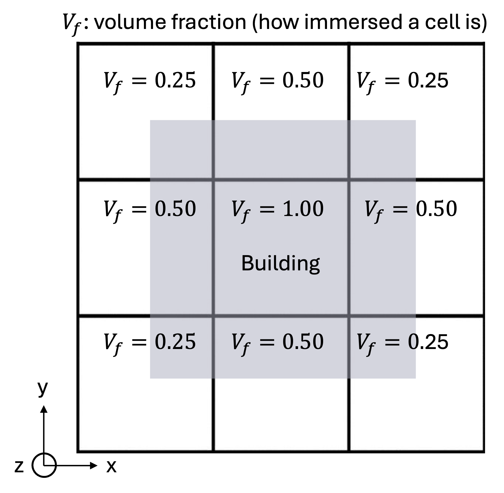

 .. role:: cpp(code)
    :language: c++

 .. role:: f(code)
    :language: fortran

.. _Forcings:

Physical Forcings
=================

Physical forcings available in ERF comprise the standard source terms for atmospheric modeling.
These include Coriolis and geostrophic forcing; Rayleigh damping and sponge layer(s); subsidence;
simplified radiative thermal sources; solution nudging towards a prescribed input sounding; and
nudging towards observations at stations (:ref:`sec:ObsNudging`).

ERF also supports models for wind farm parametrization in which the effects of wind turbines are represented
by imposing a momentum sink on the mean flow and/or turbulent kinetic energy (TKE).
Currently the Fitch model, Explicit Wake Parametrization (EWP) model, Simplified Actuator Disk model (SAD),
and Generalized Actuator Disk model (GAD) are supported. See :ref:`sec:WindFarmModels` for more information.

Below is more detail on how to set the forcing terms.

Buoyancy
--------

If

::

      use_gravity == true

then buoyancy is included in the momentum equations.  See :ref:`Buoyancy` for more detail
about the possible formulations of the buoyancy term.

Coriolis Forcing
----------------

If

::

      use_coriolis == true

then Coriolis forcing is included in the momentum equations, i.e. :

.. math::

  \mathbf{F} = (C_f \; (\rho v \sin{\phi} - \rho w \cos{\phi}), -C_f \; \rho u \sin{\phi}, C_f \; \rho u \cos{\phi})

where :math:`C_f = 4 \pi / P_{rot}` is the Coriolis factor with :math:`P_{rot}` the rotational
period (measured in seconds), and :math:`\phi` the latitude.

Values for ``erf.rotational_time_period``, ``erf.latitude``, and ``erf.coriolis_3d``; the first two are used
to compute the Coriolis frequency and the last of these determines whether to include the z-component in the Coriolis forcing.

When initializing from a ``wrfinput`` or ``met_em`` file, the latitude at the grid cell centers will be known. For this case, a user may specify

::

      variable_coriolis == true

to use the grid latitude, :math:`\phi(y)`, when computing the sine and cosine coefficients above.

There is no dependence on the radial distance from the center of the earth, thus the curvature of the earth is neglected.

Rayleigh Damping
----------------

Rayleigh damping can be imposed on any or all of :math:`u, v, w, T` by
setting one or more of
::

      erf.rayleigh_damp_U = true
      erf.rayleigh_damp_V = true
      erf.rayleigh_damp_W = true
      erf.rayleigh_damp_T = true

in the inputs file.  The time integration of the damping terms is controlled
by ``erf.rayleigh_damping_type``.  Rayleigh damping is disabled when all four
``rayleigh_damp_*`` flags are false.

When one or more of those flags is true and
the Rayleigh damping type is set to ``SlowExplicit`` or ``FastExplicit``,
then explicit Rayleigh damping is included in the energy and/or momentum equations
in the form described in Section 4.4.3 of the WRF Model Version 4 documentation (p40), i.e. :

.. math::

  \mathbf{F} = - \tau(z) \rho \; (u - \overline{u}, v - \overline{v}, w - \overline{w})

and

.. math::

  F_{\rho \theta} = - \tau(z) \rho (\theta - \overline{\theta})

where :math:`(\overline{u}, \overline{v}, \overline{w})` is the reference
state velocity, typically defined as the initial horizontally homogeneous
fields in idealized simulations, and :math:`\overline{\theta}` is the
reference state potential temperature.  The default Rayleigh helper sets
constant reference values from ``prob.rayleigh_U_0``, ``prob.rayleigh_V_0``,
``prob.rayleigh_W_0``, and ``prob.rayleigh_T_0``.  If the initialization type
is ``Input_Sounding``, ERF overwrites :math:`\overline{u}`,
:math:`\overline{v}`, and :math:`\overline{\theta}` with the sounding profiles
and sets :math:`\overline{w}=0`.  Problem setups can also override
``erf_init_rayleigh`` to define custom vertical reference profiles.

The height-dependent damping coefficient is

.. math::

   \tau(z) = \alpha R(z),

where :math:`\alpha` is ``erf.rayleigh_dampcoef`` in :math:`\mathrm{s}^{-1}`.
Thus ``rayleigh_dampcoef`` is an inverse damping timescale: if
:math:`R(z)=1`, perturbations from the reference profile are damped with
timescale :math:`1/\alpha`.

The nondimensional vertical ramp :math:`R(z)` is set by
``erf.rayleigh_zdamp``:

.. math::

   R(z) =
   \begin{cases}
   \sin^2\left[\frac{\pi}{2}
      \left(1 - \frac{z_\mathrm{top} - z}{H}\right)\right],
      & z > z_\mathrm{top} - H, \\
   0, & z \le z_\mathrm{top} - H,
   \end{cases}

where :math:`H` is ``erf.rayleigh_zdamp`` and :math:`z_\mathrm{top}` is the
model top.  The ramp is zero at the bottom of the damping layer
(:math:`z=z_\mathrm{top}-H`) and increases smoothly to one at the model top.
For :math:`u`, :math:`v`, and :math:`\theta`, ERF evaluates this ramp at
cell-center heights.  For :math:`w`, ERF evaluates it at the vertically
staggered :math:`w` levels.  Setting ``rayleigh_zdamp`` larger than the domain
height makes the ramp start below the domain; very large values make
:math:`R(z) \approx 1` throughout the domain, giving nearly uniform damping.

If the Rayleigh damping type is set to SlowExplicit then all the damping terms are computed once per
RK stage; if the type is FastExplicit then the damping terms are computed once per acoustic substep.
Either way, they are added explicitly.

If the Rayleigh damping type is set to FastImplicit then the damping term for w only is included implicitly
within the acoustic substepping algorithm (when ``erf.rayleigh_damp_W`` is true), and is not also added
explicitly; any additional Rayleigh damping (e.g. for u, v, or T) occurs as if the type is FastExplicit.
The implicit form damps w towards zero rather than towards the reference profile.

A level that takes no acoustic substeps (anelastic, pseudo-incompressible, or
``RK3_NoSubstepping``) has no substeps to apply them in, so with FastExplicit or FastImplicit
it computes all the damping terms once per RK stage, as with SlowExplicit.

The algorithm for FastExplicit is as described in (3.44) of the `MPAS report`_
which is equivalent to that written in (9) of
`Klemp, Dudhia & Hassiotis, An Upper Gravity-Wave Absorbing Layer for NWP Applications (2008)`_.

.. _`MPAS report`: https://www2.mmm.ucar.edu/projects/mpas/mpas_website_linked_files/MPAS-A_tech_note.pdf

.. _`Klemp, Dudhia & Hassiotis, An Upper Gravity-Wave Absorbing Layer for NWP Applications (2008)`: https://journals.ametsoc.org/view/journals/mwre/136/10/2008mwr2596.1.xml

Sponge regions
----------------------

ERF provides the capability to apply sponge source terms near domain boundaries to prevent spurious reflections that otherwise occur
at the domain boundaries if standard extrapolation boundary condition is used. The sponge zone is implemented as a source term
in the governing equations, which are active in a volumetric region at the boundaries that is specified by the user in the inputs file.
Currently the target condition to which the sponge zones should be forced towards is to be specified by the user in the inputs file.

.. math::

   \frac{dQ}{dt} = \mathrm{RHS} - A\xi^n(Q-Q_\mathrm{target})

where RHS are the other right-hand side terms. The parameters to be set by the user are -- `A` is the sponge amplitude,
`n` is the sponge strength and the :math:`Q_\mathrm{target}` -- the target solution in the sponge.
:math:`\xi` is a linear coordinate that is 0 at the beginning of the sponge and 1 at the end.
Sponge damping may be switched on independently at any of the six domain
boundaries, with ``erf.use_xlo_sponge_damping``, ``erf.use_xhi_sponge_damping``,
``erf.use_ylo_sponge_damping``, ``erf.use_yhi_sponge_damping``,
``erf.use_zlo_sponge_damping`` and ``erf.use_zhi_sponge_damping``.  Each side
that is switched on also requires the coordinate at which its sponge ends
(``erf.xlo_sponge_end``, ``erf.ylo_sponge_end``, ``erf.zlo_sponge_end``) or
starts (``erf.xhi_sponge_start``, ``erf.yhi_sponge_start``,
``erf.zhi_sponge_start``); the run aborts if that coordinate is not given.  The
full list of sponge inputs, with acceptable values and defaults, is in
:ref:`sec:SpongeInputs`.

An example of the sponge inputs can be found in ``Exec/RegTests/Terrain2d_Cylinder`` and is given below.
This list of inputs specifies sponge zones in the inlet and outlet of the domain in the x-direction
and the outlet of the domain in the z-direction; the y-direction and low-z sides are configured the
same way with their own inputs. The `start` and `end` parameters specify the starting
and ending of the sponge zones. At the inlet, the sponge starts at :math:`x=0` and at the outlet
the sponge ends at :math:`x=L` -- the end of the domain. The sponge amplitude `A` has to be adjusted in a
problem-specific manner.
In addition to the density and the :math:`x, y, z` velocities, ERF can now also
relax :math:`\rho \theta` and :math:`\rho q_v` in the sponge zones.
These are controlled with ``erf.sponge_rhotheta`` and ``erf.sponge_rhomoist``, respectively.
If either scalar target is omitted or set to a negative value,
ERF falls back to the local base-state target, i.e. :math:`\rho_0 \theta_0`
for ``erf.sponge_rhotheta`` and :math:`\rho_0 q_{v,0}` for ``erf.sponge_rhomoist``,
where :math:`\rho_0` is the dry base-state density.

::

          erf.sponge_strength = 10000.0
          erf.use_xlo_sponge_damping = true
          erf.xlo_sponge_end = 4.0
          erf.use_xhi_sponge_damping = true
          erf.xhi_sponge_start = 26.0
          erf.use_zhi_sponge_damping = true
          erf.zhi_sponge_start = 8.0

          erf.sponge_density = 1.2
          erf.sponge_rhotheta = 360.0
          erf.sponge_rhomoist = 0.012
          erf.sponge_x_velocity = 10.0
          erf.sponge_y_velocity = 0.0
          erf.sponge_z_velocity = 0.0

In that example, ``erf.sponge_density`` and the velocity targets define the momentum sponge state, while ``erf.sponge_rhotheta`` and ``erf.sponge_rhomoist`` define the target values for the conserved potential-temperature and water-vapor fields. If more than one moisture species is present, only :math:`\rho q_v` is relaxed to the specified sponge target; the remaining moisture species are damped toward zero in the sponge region.

Another way of specifying sponge zones is by providing the sponge zone data as a text file input. This is currently implemented only for forcing :math:`x` and :math:`y` velocities in the sponge zones.
The sponge data is input as a text file with 3 columns containing :math:`z, u, v` values.
An example can be found in ``Exec/CanonicalTests/Idealized_Terrain/WitchOfAgnesi`` and a sample inputs list for using this feature is given below.
This list specifies a sponge zone in the inlet in the x-direction.
The :math:`u` and :math:`v` velocity forcing in the sponge zones will be read in from the text file -- `input_sponge_file.txt`.

::

          erf.sponge_type = "input_sponge"
          erf.input_sponge_file = "input_sponge_file.txt"
          erf.sponge_strength = 1000.0
          erf.use_xlo_sponge_damping = true
          erf.xlo_sponge_end = 4.0

Immersed forcing to represent terrain
-------------------------------------

An additional option for representing terrain in ERF is to use an immersed forcing method where large body forces are applied to the momentum equations as sinks to force the velocity to near zero or to a desired value.
This method follows the methods of `Chan and Leach (2007) <https://doi.org/10.1175/2006JAMC1321.1>`_ and `Muñoz-Esparza et al. (2020) <https://doi.org/10.1029/2020MS002141>`_, but is expanded to allow the user to utilize a wall-model (based on Monin Obukhov similarity theory, :ref:`sec:surface_layer`).
During initialization, we determine a mask (:math:`\beta_r`) over the entire domain by calculating each cell's volume fraction, which indicates how much of a cell is filled by terrain.
Fully immersed cells have a value of 1, free cells have a value of 0, and partially immersed cells have a value between 0 and 1.
The goal is to force interior cells to near-zero velocities using the following formulation:

.. math::

    F_{\rho u_i} = -C_{d,m} \beta_r \left(\sqrt[3]{\Delta x_1 \Delta x_2 \Delta x_3}\right)^{-1} \rho u_i U

where :math:`C_{d,m}` is a drag coefficient and :math:`U` is the wind speed magnitude.
The drag coefficient can be specified by the user using ``erf.if_Cd_momentum``, which defaults to a value of 10.
A larger drag coefficient results in smaller velocities for immersed cells but may require a smaller timestep due to the stiffness of the force.

For partially immersed cells, the user has the option to specify whether to use MOST: ``erf.if_use_most``.
If the user does not specify MOST, then the equation above will be applied and there is an implicit no-slip boundary condition.
If the user does specify MOST, then the following formulation is applied to partially immersed cells:

.. math::

    F_{\rho u_i} = -C_{d,m} (1 - \beta_r) \left(\sqrt[3]{\Delta x_1 \Delta x_2 \Delta x_3}\right)^{-1} \rho |U_s| (u_i - u_{i,target})

where :math:`u_{i,target}` is a value determined through MOST and :math:`|U_s|` is a unit velocity scale.
This formulation essentially forces the velocity at the wall to a value determined by using MOST, but the strength forcing is inversely related to how immersed the cell is.
For cells that are more immersed, there is weaker forcing to the target velocity while for cells that are less immersed, there is stronger forcing to the MOST value.

**Fraction-stress wall law.** With ``erf.if_wall_form = fraction_stress`` the MOST relaxation above is replaced
by a wall stress (form 7 of the immersed terrain of Kynema-SGF; the default, ``legacy``, is the relaxation above
and is unchanged). Each column meets the air in its *wall cell*: a partially immersed cell with free cells above
it, or, when the surface lies on a cell face, the free cell sitting on the fully immersed cell. With :math:`\beta`
the immersed fraction of the wall cell (zero for a free wall cell), the surface is at
:math:`h = z_{bot} + \beta \Delta z`, the fluid centroid of the wall cell at :math:`d_1 = (1 - \beta)\Delta z/2`
above it and the centre of the cell above at :math:`d_2 = (3/2 - \beta)\Delta z`. The friction velocity mixes
the wall cell's own estimate and the one of the better resolved cell above by the fraction,

.. math::

    u_*^2 = (1 - \beta)\left(\frac{\kappa |u_{t}|}{\ln(d_1/z_0)}\right)^2
          + \beta \left(\frac{\kappa |u_{t,ref}|}{\ln(d_2/z_0)}\right)^2,

so a face-aligned surface (:math:`\beta = 0`) gets the surface-layer law of flat ground at :math:`\Delta z/2`
and a thin sliver takes :math:`u_*` from above (distances floored at :math:`2 z_0`). The stress is spread over
the cell height and integrated exactly over the step,

.. math::

    F_{\rho u_i} = -\rho\, \frac{1 - e^{-r \Delta t}}{\Delta t}\, u_i, \qquad
    r = \frac{u_*^2}{\Delta z\, |u_t|},

with :math:`u_t` the horizontal velocity, and the vertical diffusive momentum flux through the bottom face of
the wall cell is switched off (explicit stress and implicit solve), so the column loses exactly :math:`u_*^2`
through the wall. Fully immersed cells and partial cells below the wall cell keep the drag above; the wall cell
has none. The solver differences the face above the wall cell over :math:`\Delta z`, although the wall cell's
fluid centroid and the centre of the cell above are :math:`d_2 - d_1 = (1 - \beta/2)\Delta z` apart; left alone
this acts like a smaller roughness (a constant speed offset aloft, 1.5 to 3 % in the neutral ABL). The diffusive
coupling through that face (momentum, strain, :math:`\theta`, TKE, scalars, moisture) is therefore scaled by
:math:`\Delta z / \Delta z_{eff}` with, by default (``erf.if_wall_face_spacing = log``),
:math:`\Delta z_{eff} = (d_1 + d_2) \ln(d_2/d_1) / (2 \ln 3)`, the spacing that gives the face flux, with the
face viscosity the mean of the two cells' :math:`\kappa u_* z`, the same relative error for a log profile as the
first interior face of flat ground, :math:`\ln 3\, u_*^2` for every :math:`\beta` (:math:`\Delta z_{eff} = \Delta z`
for :math:`\beta = 0`); ``physical`` uses :math:`d_2 - d_1` and ``grid`` leaves :math:`\Delta z`. The factor is
bounded only while :math:`z_0 < \Delta z/4`, which the inputs require. With a RANS closure
the wall distance is measured from :math:`h`, with the wall cell at :math:`d_1` (see :ref:`RANS <RANS>`).

Stratification enters through the MOST stability functions of the flat surface layer (Dyer,
or QNSE on the stable side with ``erf.most.stable_functions = qnse``),
:math:`\ln(d/z_0) \to \ln(d/z_0) - \psi_{m,h}(d/L)`, with one surface condition:
``erf.if_surf_temp_flux`` (a kinematic heat flux :math:`q`, :math:`\theta_* = -q/u_*`),
``erf.if_init_surf_temp`` (a surface temperature :math:`\theta_s`, changing at
``erf.if_surf_heating_rate`` [K/h] when that is set, with
:math:`\theta_* = (1-\beta)\kappa(\theta - \theta_s)/\phi_h(d_1) + \beta\kappa(\theta_{ref} - \theta_s)/\phi_h(d_2)`,
mixed as :math:`u_*`) or ``erf.if_Olen`` (a fixed Obukhov length, :math:`\theta_* = \theta u_*^2/(\kappa g L)`).
With a flux or a surface temperature :math:`L = u_*^2 \theta / (\kappa g \theta_*)` is iterated with
:math:`u_*` inside the step (12 fixed passes, :math:`u_*` floored at 1 mm/s and :math:`d_1/L` kept within
:math:`\pm 100`). As on flat ground, the stable given-flux problem has no solution below a wind threshold
(about 3 m/s at :math:`q = -0.02` K m/s, :math:`d_1 = 10` m, :math:`z_0 = 0.1` m), where :math:`u_*` falls to
its floor and the wall carries almost no stress; a surface temperature avoids that. The wall heat flux :math:`-u_*\theta_*` is spread over the cell height
(integrated exactly toward :math:`\theta_s` when a surface temperature is given), the diffusive
fluxes of every scalar (:math:`\theta`, TKE, the passive scalars and the moisture species) through
the wall face are switched off, the TKE buoyancy on that face
takes the wall heat flux, and the strain and :math:`\partial\theta/\partial z` of the wall cell use the
stencils of the flat surface (the strain of the face above; the wall cell itself below it), so a
surface on a cell face reproduces flat ground. With a moisture model the microphysics species the host
transports keep their initial value in fully immersed cells, as :math:`\rho` and :math:`\theta` do (the
lateral faces of a slope stay open to diffusion, as for :math:`\theta`), and the wall law carries a
surface moisture condition for the water vapour, as the flat surface layer does: ``erf.if_surf_moist_flux``
(a kinematic moisture flux :math:`F_q` [kg/kg m/s], :math:`q_* = -F_q/u_*`, as ``erf.most.surf_moist_flux``) or
``erf.if_surf_moist`` (a surface mixing ratio :math:`q_s` [kg/kg], as ``erf.most.surf_moist``, with
:math:`q_* = (1-\beta)\kappa(q - q_s)/\phi_h(d_1) + \beta\kappa(q_{ref} - q_s)/\phi_h(d_2)`, mixed as
:math:`\theta_*`); without either :math:`q_* = 0` (no evaporation or deposition). The wall moisture flux
:math:`-u_* q_*` is spread over the cell height of the wall cell (integrated exactly toward :math:`q_s` when
a surface mixing ratio is given), written on the wall face as the water-vapour flux the TKE buoyancy and the
output read, and the Obukhov length is formed from the virtual potential temperature, as the flat surface layer
forms it: :math:`L = u_*^2 \theta_v / (\kappa g \theta_{v*})` with :math:`\theta_v = \theta(1 + \epsilon_v q)` and
:math:`\theta_{v*} = \theta_*(1 + \epsilon_v q) + \epsilon_v \theta q_*` (water vapour only; the flat surface
layer's :math:`\theta_v` subtracts rain water too), iterated with :math:`u_*` also when only
a moisture condition is given; a given ``erf.if_Olen`` sets :math:`\theta_{v*}`, and
:math:`\theta_* = (\theta_{v*} - \epsilon_v \theta q_*)/(1 + \epsilon_v q)`. Under ``erf.rans_moist_buoyancy`` the wall TKE below uses
:math:`B = -g u_* \theta_{v*}/\theta_v`, as ``erf.dirichlet_k`` does on flat ground. With the k-equation closure, ``erf.rans_moist_buoyancy`` makes the
TKE buoyancy production read the water-vapour flux too (see :ref:`RANS <RANS>`), so a heated, evaporating
surface on a cell face reproduces flat ground. The option needs ``erf.if_use_most = true``, a
constant-:math:`\Delta z` mesh and the anelastic model (the compressible fast substep does not carry the wall
heat flux and the wall TKE); ``erf.if_stability_correction`` belongs to the legacy law. With a RANS closure the
geometric length scale over the immersed surface is :math:`\kappa (d + z_0)` with ``erf.if_z0``, as it is
:math:`\kappa (d + z_0)` with the surface layer's roughness on flat ground.
With the k-equation RANS closure, ``erf.if_wall_tke = true`` holds the TKE of the wall cell at
:math:`k_w = (u_*^3 + \kappa B d_1)^{2/3}/C_{\mu 0}^2`, with :math:`B = -g u_*\theta_*/\theta` in unstable
conditions (zero otherwise) and :math:`d_1` the fluid-centroid height of the wall cell. This is the value
``erf.dirichlet_k`` holds in the first cell over flat ground (Axell and Liungman 2001, Eq. 16), and it is
held the same way: after every stage and in the implicit TKE solve (``erf.if_wall_tke_time_factor = 1``,
the default); a larger factor relaxes toward it as a source over that many steps instead, as kynema-sgf
does. Without the wall value the wall cell's TKE is set by its own production, which the strain of the
face above overstates against the pinned first cell of flat ground. A partial wall cell also dissipates
TKE with the length scale of flat ground's first cell (``erf.if_flat_wall_dissipation``, on by default with
this law): its own length, at :math:`d_1`, would make a nearly solid wall cell dissipate several times faster
than the wall value restores it. See `erf-model/ERF#4134 <https://github.com/erf-model/ERF/issues/4134>`_.

With the anelastic model the solid cells are also held by the projection. By default the drag of the
solid is a source term, the projection (which treats the solid as fluid) then adds a pressure
correction there, and the faces between two fully solid cells are set to zero after it. The face
between a solid and a fluid cell keeps its projected flux, so the solid cell under it is left with a
net inflow or outflow: the solid row under the surface becomes a mass sink and source wherever the
flow crosses the surface, and :math:`\theta` drifts. ``erf.if_implicit_projection = true`` applies the
drag inside the projection instead. On each face

.. math::

    m^{n+1} = \frac{m^* - \nabla\phi}{1 + \Delta t\, r}, \qquad
    \nabla\cdot\left(\sigma \nabla\phi\right) = \nabla\cdot\left(\sigma m^*\right), \qquad
    \sigma = \frac{1}{1 + \Delta t\, r},

with :math:`r = \beta_f\, C_{d,m} / \sqrt[3]{\Delta x_1 \Delta x_2 \Delta x_3}` the drag rate of the source
term (:math:`\beta_f` the solid fraction of the face, without the cap :math:`\min(1, U)` the source term
applies) and :math:`r = 0` on the faces where the MOST wall law acts instead. The variable-coefficient
equation is solved with GMRES, preconditioned by the FFT Poisson solve, so it needs a
constant-:math:`\Delta z` mesh with map factors of one and a build with FFT. The source term then drops
its drag, and the solid faces are not zeroed after the projection: the projected momenta are
divergence free in every cell, the solid included. The pressure gradient kept for the next step is
:math:`\nabla\phi / \Delta t` itself. The same option applies to immersed-forcing buildings (see
:ref:`below <sec:IFBuildingsImplicitProjection>`), but not to terrain and buildings immersed forcing
together.

Temperature forcing is also available to represent the temperature of the 'surface'.
The user can specify either a surface temperature and heating rate, a surface flux, or an Obukhov length.
The temperature forcing is then formulated as follows:

.. math::

    F_{\rho\theta} = -C_{d,s} \beta_r \left(\sqrt[3]{\Delta x_1 \Delta x_2 \Delta x_3}\right)^{-1} |U_s| (\rho \theta_{target} - \rho\theta)

The target temperature :math:`\theta_{target}` is straightforward when using a surface temperature and heating rate; when specifying a surface flux or Obukhov length, the target temperature is determined using MOST.
``erf.if_stability_correction`` governs the temperature kernels as it does the momentum kernels
(`erf-model/ERF#4931 <https://github.com/erf-model/ERF/issues/4931>`_): off (the default), :math:`\psi_m = \psi_h = 0`
on every branch, so :math:`u_* = \kappa U / \ln(1.5\,\Delta/z_0)` and the target is
:math:`\theta_{target} = \theta_{above} - (\theta_*/\kappa) \ln 3`, with :math:`\theta_* = -q/u_*` from a prescribed
flux :math:`q` (through the bounded Obukhov length below, so exactly while neither the bound on :math:`L` nor the clamp on
:math:`u_*` binds) and :math:`\theta_* = \theta u_*^2/(\kappa g L)` from a prescribed Obukhov length :math:`L`; the given
flux or length still sets the wall heat, only the stratification of the profile is dropped (:math:`u_*` is held in
:math:`[0, 2]` m/s on every branch; with a prescribed length the wall heat flux is then :math:`q = -\theta u_*^3/(\kappa g L)`
with the neutral :math:`u_*`, so :math:`L` sets the flux and no longer the shape of the profile). Before #4931 the
temperature kernels applied the similarity functions whatever the flag said, so a deck with a flux and the default
flag ran the log law for momentum and the stability-corrected profile for :math:`\theta`.

The stability estimate of the wall law is bounded as on flat ground (:ref:`sec:surface_layer`):

- an Obukhov length derived from :math:`u_*` and the heat flux is held at :math:`|L| \ge 1.5\,\Delta / 100`,
  and every :math:`\zeta = z/L` at :math:`|\zeta| \le 100`, at both heights the law uses (:math:`0.5\,\Delta`
  and :math:`1.5\,\Delta`, with :math:`\Delta` the cell size normal to the wall); a prescribed
  ``erf.if_Olen`` is used as given, with only its :math:`\zeta` held, so the same length applies on every
  face and at every height;
- with a prescribed ``erf.if_Olen`` (immersed terrain; the building faces have no prescribed-length branch,
  so ``erf.if_Olen`` gives them no temperature forcing), :math:`u_*` is held in :math:`[0, 2]` m/s as in the
  other branches, and :math:`\psi_h` is capped at :math:`\ln(z/z_0)` as in the other temperature branches.
  Wherever :math:`\psi_m` reaches :math:`\ln(1.5\,\Delta/z_0)` (where :math:`u_*` would turn negative), both
  :math:`\psi_h` caps bind, since :math:`\psi_h \ge \psi_m` in unstable air, and the target is the cell
  above.

Without the first, a calm cell gives :math:`u_* = 0`, :math:`L = 0` and an infinite :math:`\zeta`.
Where neither binds the law is unchanged.

Two bounds of WRF's revised surface layer are available as options, both off by default:

- ``erf.if_stability_wind_floor`` (WRF and the flat-ground surface layer use 0.1 m/s) floors the tangential
  wind behind the friction velocity of the stability estimate; the velocity target itself uses the actual
  wind, so the floor does not push a calm cell;
- ``erf.if_psi_cap_factor`` :math:`f` (WRF uses 0.9) caps :math:`\psi_m` at :math:`f\ln(z/z_0)` in the
  velocity target and before it forms :math:`u_* = \kappa U / (\ln(1.5\,\Delta/z_0) - \psi_m)`, so that
  strongly unstable air keeps a positive :math:`u_*` and a nonzero target (a cap of :math:`\ln(z/z_0)` makes
  the target zero, and a :math:`\psi_m` past :math:`\ln(1.5\,\Delta/z_0)` sets :math:`u_* = 0`).

With the flag on, the temperature forcing keeps caps of :math:`\ln(z/z_0)` on :math:`\psi_h` on every branch: its surface-flux branch forms
:math:`\theta_*` from an Obukhov length that is not consistent with :math:`u_*`, which those caps keep from
reaching the target in strongly unstable air. The legacy law is kept as it is; the fraction-stress law of
`erf-model/ERF#4134 <https://github.com/erf-model/ERF/issues/4134>`_ forms :math:`u_*`, :math:`\theta_*` and
:math:`L` consistently.
ERF prints both values at start-up when an option is set and the wall law's stability estimate is in use.

The following inputs are available when representing terrain using immersed forcing:

::

        erf.if_Cd_scalar               = FLOAT
        erf.if_Cd_momentum             = FLOAT
        erf.if_z0                      = FLOAT
        erf.if_surf_temp_flux          = FLOAT
        erf.if_init_surf_temp          = FLOAT
        erf.if_surf_heating_rate       = FLOAT
        erf.if_Olen                    = FLOAT
        erf.if_surf_moist_flux         = FLOAT
        erf.if_surf_moist              = FLOAT
        erf.if_use_most                = BOOL
        erf.if_wall_form               = STRING
        erf.if_wall_face_spacing       = STRING
        erf.if_wall_tke                = BOOL
        erf.if_wall_tke_time_factor    = FLOAT
        erf.if_flat_wall_dissipation   = BOOL
        erf.if_implicit_drag           = BOOL
        erf.if_average_down            = STRING
        erf.if_cf_mismatch_warning     = FLOAT
        erf.immersed_forcing_substep   = BOOL

An example of using immersed forcing for a Witch of Agnesi hill is available in ``Exec/RegTests/ImmersedForcingTest``.

**Mesh refinement.** Each level builds its own solid fraction :math:`\beta` and forces its own solid and partial
cells, so near the surface the levels disagree about the geometry. With two-way coupling the covered coarse cells
take the average of the fine cells over them. The plain cell average (``erf.if_average_down = plain``, the default)
mixes the values of solid fine cells into coarse fluid and partial cells. With ``erf.if_average_down = fluid_mass``
the fine cells are weighted by their fluid mass,

.. math::

   (\rho \phi)_c = \rho_c \, \frac{\sum_f (1-\beta_f)\, V_f\, (\rho \phi)_f}{\sum_f (1-\beta_f)\, V_f\, \rho_f},

with :math:`V_f` the fine cell volume (:math:`\det J / (m_x m_y)`, the weight the plain average carries) and
:math:`\rho_c` the coarse density: the coarse cell's own base-state density when the density is not averaged
(anelastic), and the fluid-volume-weighted mean of the fine density when it is (compressible). Coarse cells that
are solid on their own level, or with no fluid fine cell under them, keep their value. The coarse value is the
fluid mean over the whole coarse cell, so the integral of :math:`\rho\phi` over a covered partial cell is
:math:`1/(1-\beta_c)` times the fine fluid integral: this average is not conservative over the covered region,
where the plain average is. The face momenta keep the plain average with either setting: it is the fine mass flux
through the coarse face, which keeps the anelastic constraint. See
`erf-model/ERF#4918 <https://github.com/erf-model/ERF/issues/4918>`_.

**Coarse/fine faces that cross the surface.** A refined patch whose lateral coarse/fine faces cross the surface
takes its face momenta there from the coarse level, which is open over the whole coarse face. With the explicit
treatment of the solid (``erf.if_implicit_projection = false``, the default) the projection makes the momenta
divergence free and the solid is frozen afterwards, so the partial cells at the patch edges keep a divergence of
their own, which advects a uniform :math:`\theta` into a spurious source. With ``erf.if_implicit_projection = true``
the drag is applied inside the projection and the solid is not frozen, and the momenta stay divergence free in the
partial cells: multi-level anelastic runs with immersed forcing should use it. The ``ImmersedLES2LevHeatBalance``
test (a plane at 45 m, a two-level patch, 20 steps) requires the fluid-mass-weighted mean :math:`\theta` of the
domain to stay within 1e-6 K of its uniform start with the implicit projection, and checks that the explicit
freeze exceeds that. Where the surface lies on the mid-plane of a coarse cell, the two levels describe different
walls along the coarse/fine faces and the fill errors are largest; ``erf.if_cf_mismatch_warning`` (a spread of
fine solid fractions, default 0.75; 0 turns it off) counts those coarse cells at start-up and prints a warning.
The log-law share of the wall coarse face's flux, ``erf.cf_loglaw_fill``, applies to immersed surfaces too (see
:ref:`Mesh refinement <MeshRefinement>`). See
`erf-model/ERF#4920 <https://github.com/erf-model/ERF/issues/4920>`_.

.. note:: When using fully compressible simulations, it is recommended to apply immersed forcing on the substep for numerical stability.

.. note:: By default (``erf.if_implicit_drag = false``) the momentum drag is applied with an explicit (forward-Euler) source term. Setting ``erf.if_implicit_drag = true`` switches to a point-implicit (linearly-implicit) formulation of the same drag, which is unconditionally stable and prevents momentum overshoot in stiff (high :math:`C_{d,m}`) or large-timestep regimes such as anelastic runs without acoustic substepping.

Immersed forcing to represent buildings
---------------------------------------

The immersed forcing capability can also be used to represent buildings.
The user can specify the use of a wall model (``erf.if_use_most = true``), which follows Monin Obukhov similarity theory but is slightly different than the formulation as described above as there are now horizontal wall cells.
However, the default behavior is to not use the wall model ((``erf.if_use_most = false``)), in which the behavior would be identical to the first equation described in the previous section.

The top-down schematic below can help breakdown the wall-model behavior when using immersed forcing to represent buildings.

.. _fig:ImmersedForcing_Building:

   Top-down view of a building footprint when using immersed forcing.

If a cell is fully immersed (:math:`\beta_r = V_f = 1.0`), then the forcing term takes the following form:

.. math::

    F_{\rho u_i} = -C_{d,m} \left(\sqrt[3]{\Delta x_1 \Delta x_2 \Delta x_3}\right)^{-1} \rho u_i U

If a cell is partially immersed (:math:`0.0 < V_f < 1.0`), then a target velocity is calculated using MOST:

.. math::

    F_{\rho u_i} = -C_{d,m} \left(\sqrt[3]{\Delta x_1 \Delta x_2 \Delta x_3}\right)^{-1} \rho |U_s| (u_i - u_{i,target})

where :math:`u_{i,target} = \left(1 - V_f\right) u_{i,\textrm{MOST}}`. :math:`u_{i,\textrm{MOST}}` is defined as:

.. math::

      u_{i,\mathrm{MOST}} = \frac{u_{\*,i+1}}{\kappa} \left[ \log \left( \frac{0.5 \Delta x_i}{z_{0,\mathrm{w}}} \right) \right]

with

.. math::

          u_{\*,i+1} = U_{i+1, \textrm{tangent}} \frac{\kappa}{\log \left[\frac{1.5 \Delta x_i}{z_{0,\textrm{w}}} \right]}

This formulation is used for all three direction and we assume walls are orthogonal to cell faces.
If ``erf.if_stability_correction = false`` (which is the default), then MOST simply becomes the log law, for the
momentum and the temperature forcing alike (see the terrain section above).
The stability corrections are available for the similarity functions ``erf.if_stability_correction = true``; however, they should only be used with extreme caution as their validity for horizontal walls is questionable.
For additional details on this formulation, please see see `Wise et al. (2025) <https://essopenarchive.org/doi/full/10.22541/essoar.176659709.97467775/v1>`_.

Similar to the previous section, temperature forcing is also available for the building 'surface'.
However, the user should proceed with caution when specifying a surface flux or Obukhov length as this pathway is more susceptible to numerical instability as there is no temporal or spatial averaging done in the MOST formulation.
Efforts to have more realistic thermal boundary conditions using building properties and radiation are a subject of ongoing work.

Inputs that can be used with immersed forcing for buildings are as follows:

::

        erf.buildings_type             = STRING #ImmersedForcing or None
        erf.buildings_file_name        = STRING
        erf.if_Cd_scalar               = FLOAT
        erf.if_Cd_momentum             = FLOAT
        erf.if_z0                      = FLOAT
        erf.if_surf_temp_flux          = FLOAT
        erf.if_init_surf_temp          = FLOAT
        erf.if_surf_heating_rate       = FLOAT
        erf.if_Olen                    = FLOAT
        erf.if_use_most                = BOOL
        erf.if_stability_correction    = BOOL
        erf.if_implicit_drag           = BOOL
        erf.if_implicit_projection     = BOOL
        erf.immersed_forcing_substep   = BOOL

.. _sec:IFBuildingsImplicitProjection:

With the anelastic solver the building faces are held by the projection as the terrain faces are
(see above). By default the drag is a source term and the faces between two solid cells are set to
zero after the projection, so the partial cells at the walls and the roof (and, when a box edge is
not on a cell mid-plane, the solid cells next to them) keep a divergence that advects a uniform
:math:`\theta` into a spurious source.
``erf.if_implicit_projection = true`` applies the linear drag of the building kernels inside the
projection instead: :math:`r = w\, C_{d,m} / \sqrt[3]{\Delta x_1 \Delta x_2 \Delta x_3}` on each
face, without the cap :math:`\min(1, U)` the source term applies, with :math:`w` the weight of the
kernel's drag toward zero on that face: the blanking :math:`\beta_f` on a partial face without a
wall law (a partial wall face of :math:`u` or :math:`v` not under the MOST law, or the roof face of
:math:`w`), one on an interior face, and one on every face between two solid cells, which the
explicit treatment zeroes after the projection. The MOST wall law itself adds no weight: a
horizontal wall-law face has :math:`w = 0`, and a :math:`w`-face on the roof row that carries a side
wall law keeps the roof weight :math:`\beta_f`. The kernels then apply the wall law only, on the
partial faces that carry it, and the solid faces are not zeroed afterwards. The requirements are
those of the terrain case: a constant-:math:`\Delta z` mesh, map factors of one, ``erf.compressibility_type`` not ``FullyCompressible``
on every level and a build with FFT. A level coarser than the 50 m cutoff of the building forcing
(:math:`\sqrt{\Delta x \Delta y} > 50` m) has no building blanking, and its faces keep
:math:`\sigma = 1`. As for terrain, the faces on a non-periodic lateral domain boundary and on a
coarse/fine boundary keep :math:`\sigma = 1` and take their data from the boundary condition or the
coarse level. The ``ImmersedBuildingHeatBalance`` test (a box building whose walls and roof are
half-solid cells, uniform :math:`\theta`, four unequal boxes, 20 steps) requires the fluid-mass-weighted
mean :math:`\theta` of the domain to stay within 1e-6 K of its start with the implicit projection,
with and without ``erf.if_snap_partial_cells``, and checks that the explicit treatment exceeds that
(0.012 K measured). Two limits of the option, shared with the terrain case: a partial face of
:math:`w` on the roof row that carries a side wall law takes that law from the source term and the
roof drag from the projection, so its equilibrium velocity is lower than with both in one term
(by a factor :math:`1/(1 + \mu\,\Delta t)` with :math:`\mu` the law's rate); and the fully
solid cells still hold their :math:`\rho` and :math:`\rho\theta` while the small flow through them
(about :math:`0.5` m/s at :math:`C_{d,m} = 50` on 20 m cells) carries :math:`\rho\theta` in and
out of them, so with a non-uniform :math:`\theta` the building acts as a reservoir at its initial
value. Dropping the cap also makes the drag on a partial face in a slow wake (:math:`U < 1` m/s)
stronger than the source term's. See
`erf-model/ERF#4887 <https://github.com/erf-model/ERF/issues/4887>`_.

The default drag coefficients are different when using the fully compressible solver compared to the anelastic solver.
This is because the timestep used for the anelastic solver is typically much coarser compared to the substep timestep for the fully compressible solver.
A larger drag coefficient will more quickly force a cell to the desired value; however, there is a stability limit related to the timestep due to the explicit form of the drag term.
The recommended values are ``erf.if_Cd_scalar = 50.0`` and ``erf.if_Cd_momentum = 500.0`` for the fully compressible solver and
``erf.if_Cd_scalar = 5.0`` and ``erf.if_Cd_momentum = 50.0`` (note that these are the default values).
The immersed forcing formulation for buildings has been rigorously tested at grid spacings of 5.0 m and less.
Caution is needed when using immersed forcing at coarser grid spacings.
If immersed forcing is causing your simulations to become unstable, the first recommendation is to reduce the drag coefficients.

Immersed forcing for buildings can be used in conjunction with the ``StaticFittedMesh`` terrain option.
However, currently, the user must specify the z-coordinates using ``erf.terrain_z_levels``.
In the future, this requirement will be removed.
Note that the volume fraction is calculated prior to the grid transformation; therefore, building heights when located in steep terrain should be considered approximate.

An example of immersed forcing for a building located on top of a Witch of Agnesi hill is available in ``Exec/RegTests/ImmersedForcingTest``.
Additional examples are in ``Exec/RegTests/ImmersedForcingTest/wall_model`` demonstrating the wall model and different idealized thermal boundary conditions.

.. _sec:ObsNudging:

Nudging towards observations at stations
----------------------------------------

Measurements from met masts, lidars and profilers can be used to nudge the flow near
them.  Each station is a horizontal position and a time series of measured profiles
of :math:`u`, :math:`v`, :math:`w` and :math:`\theta` (any subset), optionally with the
standard deviation :math:`\sigma` of each.  A met mast is a profile of one or a few
heights, and a lidar a profile of many gates.  Only points near a station are nudged,
with a weight that falls off with the distance from it.

For one of the nudged quantities :math:`\phi`, station :math:`s` has the weight

.. math::

    w_s = \exp\left(-\frac{1}{4}\left[\frac{r_s^2}{R_h^2} + \frac{d_s^2}{R_z^2}\right]\right),

where :math:`r_s` is the horizontal distance from the point to the station (to its
nearest image in a periodic direction) and :math:`d_s` is the vertical distance from
the point to the measured height range, zero inside it.  :math:`R_h` and :math:`R_z` are
``erf.obs_nudging.horizontal_radius`` and ``erf.obs_nudging.vertical_radius``, and a
station further than ``erf.obs_nudging.cutoff`` radii away (:math:`r_s^2/R_h^2 +
d_s^2/R_z^2` above the square of the cutoff) is not used.

The target of station :math:`s` is the measured mean :math:`\bar\phi_s`, interpolated
linearly in height (and held at its end values above and below the measured range) and in
time, widened to a band of :math:`\pm\alpha\sigma_s`.  Only the part of the local value
outside the band is nudged:

.. math::

    t_s = \min\left(\max\left(\phi,\ \bar\phi_s - \alpha\sigma_s\right),\ \bar\phi_s + \alpha\sigma_s\right),

with :math:`\alpha` = ``erf.obs_nudging.sigma_factor``; :math:`\alpha = 0` nudges towards the
mean.  The stations are combined into one relaxation,

.. math::

    \frac{\partial \phi}{\partial t} = -\min\left(\frac{W}{\tau},\ \frac{1}{\Delta t}\right)\left(\phi - \bar t\right),
    \qquad W = \min\left(1,\ \sum_s w_s\right),
    \qquad \bar t = \frac{\sum_s w_s t_s}{\sum_s w_s},

where :math:`\tau` is ``erf.obs_nudging.tau`` and :math:`\Delta t` the time over which the
stage of the time step is taken.  The cap :math:`W \le 1` keeps a point from relaxing faster
than :math:`1/\tau` however many stations are near it, and the cap at :math:`1/\Delta t`
keeps it from overshooting its target within a stage when :math:`\tau < \Delta t`.  The
source added to the equation of :math:`\rho\phi` is :math:`\rho\,\partial\phi/\partial t`,
with :math:`\rho` averaged to the face of a velocity component.  For a single station at a
single height with :math:`\sigma = 0` and :math:`\tau \ge \Delta t` this is the classical
relaxation :math:`-w\,(\phi - \bar\phi)/\tau`.

The heights of a station are measured above the local terrain (or, with
``height_ref = msl``, above :math:`z = 0`).  On a terrain-fitted mesh the terrain is the
bottom of the mesh; with immersed-forcing terrain it is the terrain surface the immersed
boundary is built from, and cells inside the immersed terrain or buildings are not nudged
(the tendency is multiplied by the fluid fraction :math:`1 - \beta_r`).  EB terrain is not
supported.  The vertical velocity is not nudged on the bottom and top of the domain, where
the boundary conditions set it.

A station is placed by ``x``/``y`` in domain coordinates or, in a run with
latitude/longitude arrays (a WRF or metgrid initialization, or a restart from one), by
``lat``/``long``.  A latitude/longitude is placed with the same local inverse of the
level-0 latitude/longitude arrays as the station time-series output, so it works for any
projection.  An earth-relative wind (``wind_frame = earth``, the default) is rotated into
the grid frame with the angle :math:`\alpha_g` of the grid's :math:`x` axis from true east
at the station, measured from the same arrays:

.. math::

    u_{grid} = u_{east}\cos\alpha_g + v_{north}\sin\alpha_g, \qquad
    v_{grid} = -u_{east}\sin\alpha_g + v_{north}\cos\alpha_g.

In a run without latitude/longitude arrays the grid is taken to be aligned with east and
north.  The inputs and the station file are described in :ref:`Nudging towards observations
<inputs-obs-nudging>`.

Problem-Specific Forcing
========================

The following two options can be used to specify external forcing terms.

Pressure Gradient
-----------------

If

::

      abl_driver_type == "PressureGradient"

then

.. math::

  \mathbf{F} = (\nabla p_{x,ext}, \nabla p_{y,ext}, \nabla p_{z,ext})

where :math:`(\nabla p_{x,ext}, \nabla p_{y,ext}, \nabla p_{z,ext})` are user-specified through ``erf.abl_pressure_grad``.

Geostrophic Forcing
-------------------

If

::

      abl_driver_type == "GeostrophicWind"

then geostrophic forcing is included in the forcing terms, i.e.

.. math::

  \mathbf{F} = (-C_f \; v_{geo}, C_f \; u_{geo}, 0)

where :math:`C_f = 4 \pi / P_{rot}` is the Coriolis factor with :math:`P_{rot}` the rotational
period (measured in seconds), and the geostrophic wind :math:`(u_{geo}, v_{geo}, 0)` is
user-specified through ``erf.abl_geo_wind``.  Note that if geostrophic forcing is enabled,
Coriolis forcing must also be included.
