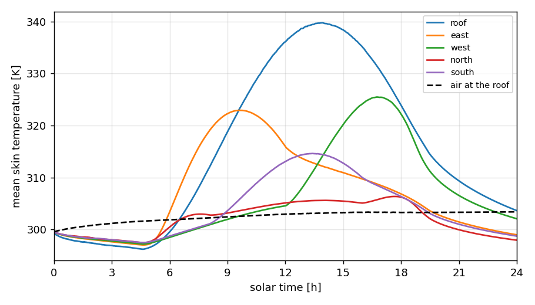
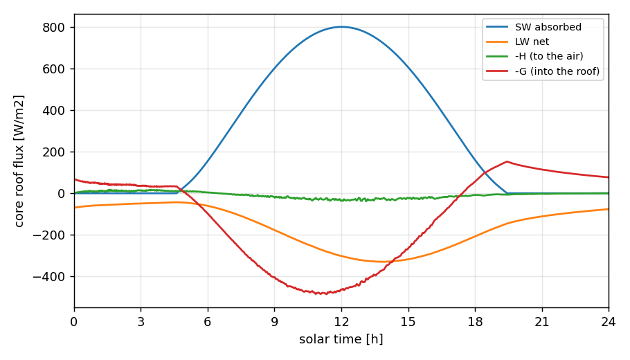
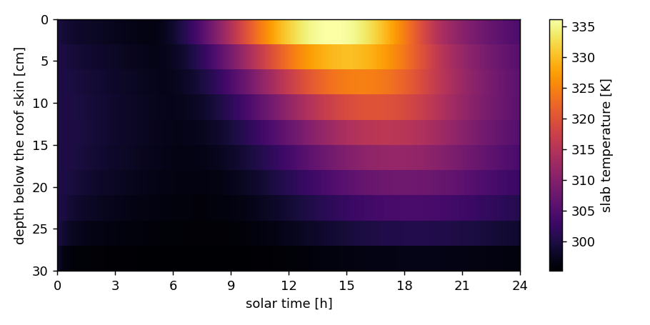
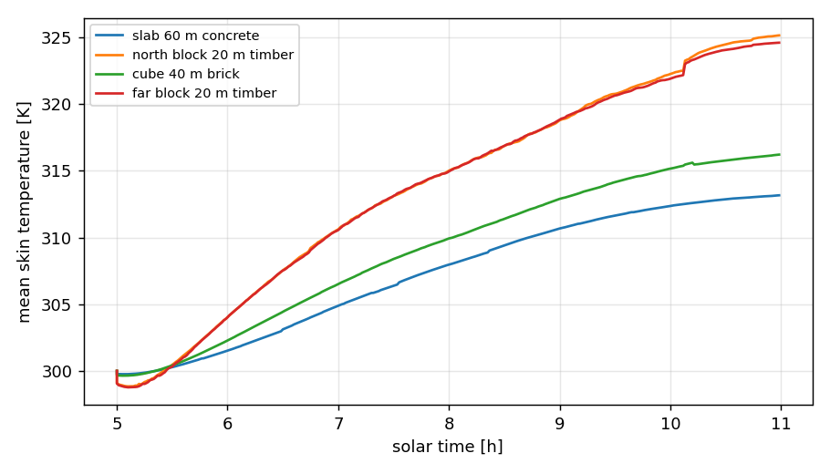
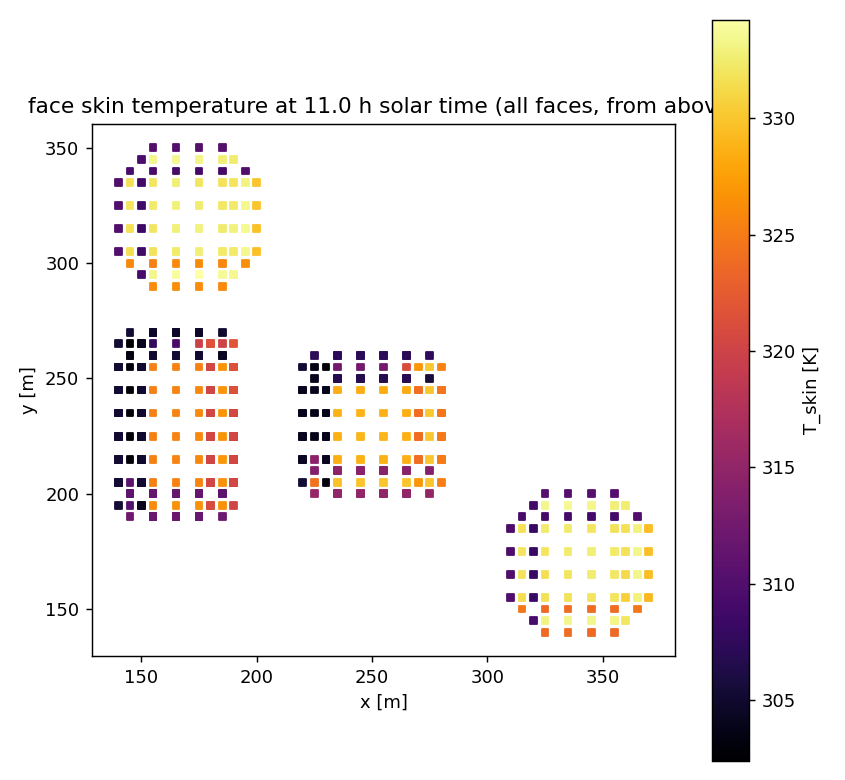

.. _sec:IBSEB:

Surface energy balance on immersed-boundary faces
=================================================

Buildings represented by immersed forcing (:cpp:`erf.buildings_type =
ImmersedForcing`) are resolved: every cell is either fluid or solid, and the
faces between them are the walls and roofs. The immersed-boundary surface
energy balance gives each such face its own skin temperature from

.. math::

   C \frac{dT_s}{dt} = SW_{abs} + LW_{net} - H - LE - G ,

with the absorbed shortwave, the net longwave, the sensible and latent heat
to the air, and the conduction into the wall. The sections below describe
each term and the case under ``Exec/CanonicalTests/SEB`` that verifies it.

Face storage
------------

A wall face lies between a fluid cell, where the blanking is below one
half, and a solid cell, where it is at or above one half. Each face is
stored once, on the rank that owns the fluid cell, as a compact list rather
than a face-centred field: the fluid cell, the face direction, the side the
solid is on, the building id, the material id, the area, the skin
temperature, the slab temperatures, the view fractions and the current
fluxes, all in device arrays, contiguous per local box. Every input the
balance needs is in the fluid cell next to the face, so the per-step update
is one kernel over the list with no communication; only the reports reduce
across ranks.

Building ids come from labelling the solid columns of the blanking, four
connected in the horizontal, across the periodic seams too, and numbered in scan order; a face carries the
id of its solid neighbour's column. The per-building report,
:cpp:`erf.ibseb.csv_file`, lists every :cpp:`erf.ibseb.csv_int` steps the
number of faces, the area, the area-weighted mean skin temperature with
its range, the mean fluxes, the largest balance residual and the sun of
the step for each building, and a ``[IBSEB]`` line prints the face counts
per direction, the number of buildings, the total area, the skin
temperature range and the mean fluxes. With
:cpp:`erf.ibseb.dump_faces_file` every face is written at the same
interval (one file per rank; :cpp:`erf.ibseb.dump_faces_tag_step` keeps
every dump), which is what the regtests and the canonical cases read. A
restart appends from its next report on: the step it starts from is printed
but not written to the report file or dumped again.

For output the list is scattered into cell-centred fields, ``ibseb_nfaces``
and ``ibseb_tskin`` in the plotfile. The checkpoint holds the faces
themselves: ``Level_N/IBSEBFaces`` carries one record per face, its skin
temperature, sensible flux and slab temperatures, keyed by the face's cell,
direction and side and written in key order by the I/O rank, so the file is
the size of the data (``8 (3 + n_slab_layers)`` bytes per face after a
header line) and is the same whatever the number of ranks. On restart the list is rebuilt from the
blanking and every face looks its record up by its key, so a restart does not
depend on the number of ranks. A checkpoint with another layer count, another
domain or other buildings is refused with a message that says so, and so is
one written before the records, which held the state as the cell field
``IBSEBState``. ``Exec/CanonicalTests/SEB/FaceStorage`` checks the face
counts against the mask, the rank independence and the checkpoint round trip,
face by face.

Shortwave and shadow
--------------------

The downwelling radiation reaches the balance through a provider,
:cpp:`erf.ibseb.radiation`. The built-in ``prescribed`` provider gives the
direct-normal irradiance, the diffuse irradiance on a horizontal surface and
the sun vector either as fixed inputs (:cpp:`erf.ibseb.sun_mode = fixed`,
for analytic tests), from the two-stream radiation's own sun (``two_stream``,
see `Refined levels`_ below for why it must be used with that model) or from
the site and time (``solar``): declination,
equation of time, hour angle, zenith and azimuth by the Spencer series
(day angle :math:`2\pi (d - 1)/365` for day of year :math:`d`, as Spencer
fitted it, shared with the Earth-Sun distance factor; :math:`d` advances by
one at each 00:00 UTC, so a run of several days follows the season), the
direct beam by the Bird transmission :math:`S_0 E_0 \tau^{1/\cos z}` and the
diffuse light as a fraction :math:`k_d` of what the beam lost on the way
down. :math:`k_d` (:cpp:`erf.ibseb.sw_diffuse_coeff`) must lie in
:math:`[0, 1]`, so the diffuse light is never negative and the direct and
diffuse light on a horizontal surface never exceed :math:`S_0 E_0 \cos z`;
the run stops at start-up otherwise. The sun vector points from a surface toward the sun, with the azimuth
clockwise from north, so east is :math:`+x` and north :math:`+y`. The
``two_stream`` provider takes the irradiances from the columns of the
two-stream radiation instead (`Radiation from the two-stream columns`_ below);
the sun vector still comes from :cpp:`erf.ibseb.sun_mode`.

On a face with outward normal :math:`\mathbf{n}` the direct beam is
:math:`I_{dn}\, \max(0, \mathbf{n}\cdot\mathbf{s})` unless the face is in
shadow. Shadow is decided by a ray cast from the face centre toward the sun
against the height of every column of the level, a two-dimensional walk over
the columns the ray crosses: buildings stand on the ground and the ray only
rises, so the ray is blocked wherever its height on entering a column is
below that column's top. The column tops are a map with one integer per
column, the index of its highest solid cell rather than its height, held on
the level's own boxes like any other field (so the grids must not be split
in z, which :cpp:`amr.no_box_split_dir = 2`, the ERF default, keeps them from
being). Each rank's ray cast reads its
own *patch* of that map: the rank's boxes grown by a halo, filled once at
initialisation by a parallel copy, so the test needs no communication and
costs a few operations per column crossed, and nothing of the size of the
domain is replicated on every rank. The halo is exact rather than a cut-off:
a rising ray stops once it passes the tallest column and a descending one
stops at the ground, so a ray reaches no further than the tallest building
divided by the tangent of its elevation, and the halo is that reach for the
shallowest ray the map must follow: the shallowest ray of the hemisphere
sampling below (set by :cpp:`erf.ibseb.view_n_az` and
:cpp:`erf.ibseb.view_n_el`) and a sun :cpp:`erf.ibseb.sun_min_elev_deg`
above the horizon (2 degrees by default, where the clear-sky direct beam is
0.05 W/m2 with the default transmission and 2.3 W/m2 at a transmission of
0.8; a fixed beam keeps its value at any elevation). A ray that leaves the patch has
left the map, and the far field is open ground: only a sun lower than that
floor is concerned, and then a building farther than the halo from a face
casts no shadow on it, which a warning says for a fixed sun. Where the
grown boxes would reach past one domain width the patch is the domain
itself: wrapped in a periodic direction, so a ray comes back in on the other
side and is followed to its end whatever its elevation, and clipped at a
non-periodic edge, beyond which nothing stands. The patch therefore never
costs more than the whole map did, 4 bytes per column of the domain per
rank, and on a city-scale deck it costs the rank's share plus the halo. With the
prescribed provider the diffuse light on a face is the sky view fraction
times the horizontal diffuse plus the ground view fraction times the ground
albedo times the total horizontal irradiance, with the fractions from the
hemisphere sampling below (the ``two_stream`` provider's terms are below). The absorbed shortwave is one minus the face
albedo times the sum. In that form the ground a face sees is sunlit everywhere;
:cpp:`erf.ibseb.ground_view_shadow` takes the buildings' shadow on that ground into
account (`The ground a face sees, sunlit and shaded`_).

View fractions and longwave
---------------------------

Once, at initialisation, every face samples a cosine-weighted hemisphere
around its outward normal: :cpp:`erf.ibseb.view_n_az` azimuths by
:cpp:`erf.ibseb.view_n_el` elevations, stratified with
:math:`\theta = \arcsin\sqrt{u}` from the normal so that every ray carries
the same weight and the counts are view factors. Each ray goes through the
same column walk as the shadow test, made direction-aware: a rising ray is
blocked by a column whose top is above its entry height and otherwise
reaches the sky; a falling ray is blocked by a column it descends into and
otherwise reaches the ground. The fractions of rays ending on the sky, the
ground and a building, :math:`f_{sky}`, :math:`f_{ground}` and
:math:`f_{bldg}`, sum to one. A roof sees no ground; a wall on open ground
sees half sky and half ground; a wall facing another building sees it.

The longwave arriving at a face is

.. math::

   LW_{in} = f_{sky}\, LW_{sky} + f_{ground}\, \varepsilon_g \sigma T_g^4
           + f_{bldg}\, \sigma T_s^4 ,

the sky term either the input :cpp:`erf.ibseb.lw_down` or, with
:cpp:`erf.ibseb.lw_mode = gray`, :math:`\varepsilon_{sky} \sigma T_{air}^4`
with the air temperature of the face's fluid cell; the ground term at the
input ground temperature; and the building term at the face's own skin
temperature, the isothermal-surroundings approximation under which a face
and the walls it sees exchange no net longwave. There are no face-to-face
view factors and no radiosity; the fractions are stored so a radiosity pass
can be added later without touching the balance. The net longwave,
:math:`\varepsilon (LW_{in} - \sigma T_s^4)`, is positive into the face.
With :cpp:`erf.ibseb.lw_mode = two_stream` the sky and ground terms come
from the two-stream columns instead (`Radiation from the two-stream columns`_).

``Exec/CanonicalTests/SEB/Longwave`` checks the fractions of every
face against an independent hemisphere sampling, their closure and the
analytic values on the clean planes, and the longwave formulas on every
face, on one and four ranks.

The ground a face sees, sunlit and shaded
-----------------------------------------

A wall receives sunlight that the ground reflects. By default the ground a
face sees is taken as sunlit everywhere, so the face gets the reflected beam
through its whole ground view fraction: a wall in a building's shadow is
then lit by sunlit ground at its own foot, where the ground is in the same
shadow. With :cpp:`erf.ibseb.ground_view_shadow = true` the reflected beam
reaches a face through the sunlit part of its ground view only. The input is
off by default, and a run without it is unchanged.

**What is counted.** Every view ray of a face that ends on the ground lands
in a column. That column's ground is shaded when the ray from the centre of
its ground toward the sun meets a building: the test of the shadow on the
faces, and the one the two-stream ground balance uses for its own shadow
(`The two-stream columns and the buildings`_). The sunlit ground view
fraction :math:`f_{lit}` is the share of all the face's rays that end on
sunlit ground, so :math:`0 \le f_{lit} \le f_{ground}`, and
:math:`f_{lit} = f_{ground}` for a face that sees no shaded ground. At
night, and wherever the ground gets no beam, :math:`f_{lit} = 0`.

**What the face then takes.** With the prescribed provider the diffuse light
on a face becomes

.. math::

   SW_{dif} = f_{sky}\, D + \alpha_g \left( f_{ground}\, D + f_{lit}\, B \right),
   \qquad B = I_{dn} \cos z ,

in place of :math:`f_{sky} D + f_{ground}\, \alpha_g (B + D)`, with

- :math:`D`: the diffuse sky light on a horizontal surface;
- :math:`B`: the direct beam on a horizontal surface, from the direct-normal
  irradiance :math:`I_{dn}` and the zenith angle :math:`z`;
- :math:`\alpha_g`: the ground albedo, :cpp:`erf.ibseb.albedo_ground`.

The shaded ground still reflects the sky's diffuse light. With the
``two_stream`` provider (`Radiation from the two-stream columns`_) the
ground's reflection is the column's shortwave going up at the face's height,
:math:`F^{\uparrow}_{SW}(z_f)`, which holds the reflected beam and the
reflected diffuse light together. The face takes

.. math::

   SW_{dif} = f_{sky} \left( F^{\downarrow}_{SW}(z_f) - F_{dir}(z_f) \right)
            + \left[ f_{ground} - (f_{ground} - f_{lit})\, s \right] F^{\uparrow}_{SW}(z_f),
   \qquad s = \frac{\alpha_{dir}\, F_{dir}(0)}{F^{\uparrow}_{SW}(0)} ,

with

- :math:`F_{dir}(0)`: the direct beam the column brings to the ground, on a
  horizontal surface;
- :math:`\alpha_{dir}`: the direct-beam albedo the two-stream sweep gave the
  column's ground, and :math:`\alpha_{dif}` its albedo for diffuse light
  (:cpp:`erf.radiation.surface_albedo_sw_diffuse`, or :math:`\alpha_{dir}`
  when that is not set);
- :math:`F^{\downarrow}_{dif}(0)`: the diffuse light arriving at the ground;
- :math:`s`: the reflected beam's share of the shortwave going up at the
  ground. There :math:`F^{\uparrow}_{SW}(0) = \alpha_{dir} F_{dir}(0) +
  \alpha_{dif} F^{\downarrow}_{dif}(0)`, so :math:`s` lies in :math:`[0, 1]`
  and is one when the sky sends no diffuse light.

**Why the share is taken at the ground.** The sweep does not keep the two
parts of the upward flux apart above the ground. Where the air between the
ground and the face only absorbs, both parts are dimmed alike on the way up
and the share at the face's height is the share at the ground, exactly (a
sky that only absorbs sends no diffuse light either, so :math:`s = 1`
there). With scattering air this is an approximation, for two reasons of
opposite sign: the light the air below the face scatters up from the beam
is counted as the ground's reflection, more so the higher the face; and the
reflected beam that the air sends back down and the ground reflects again
is counted as diffuse light. The reference is the same column solved again
over a ground the beam does not reach. In the test below (an optical depth
of 0.02 per 10 m layer, half of it scattering, far more than clear air has)
the light coming up from fully shaded ground is off by -1.4 to +7.8 W/m²
over the lowest 40 m, of 123 W/m² coming up at the ground, per unit of
shaded ground view. On the test's cube, whose faces see little shaded
ground from higher up, that is at most 0.5 W/m² of the 62 W/m² a wall
receives from the ground. The error grows with the scattering optical depth
between the ground and the face and with the ground's albedo.

**When, and what it costs.** The columns in which a face's ground rays land
do not change, so they are found once, with the view fractions, in one
pass over the rays, and kept: each distinct column once, with the number of
rays that land in it (8 bytes per column; on level 1 of
``Exec/CanonicalTests/Radiation/TwoStream_IBSEB_RandomBuildings`` the 22067
ground rays of the faces land in 13350 columns, 107 kB). Each step in which the
ground gets a beam, one ray is cast toward the sun from each of a face's
columns, whatever the number of rays that land there. In that case the faces'
balance goes from 0.12 to 0.27 ms per step on a rank with 212 faces, on one
core of a laptop. The sunlit fractions are not
part of the checkpoint; a restart finds them again. They are written in the
face dump only (:cpp:`erf.ibseb.dump_faces_file`), as the column
``f_ground_lit`` after ``f_bldg`` when the input is on; there is no plotfile
variable. With the ``two_stream`` provider the dump of the initial state,
before the first sweep, has ``f_ground_lit`` at zero like the shortwave.
With the input on, the two-stream sweep also keeps the ground's direct-beam
albedo of every column of a level whose faces read it (one 2D field); with
it off nothing is added to the sweep. With the ``two_stream`` provider the
faces' sun casts the shadows and the column's beam is what the ground
reflects. The two suns may differ by :math:`10^{-4}` in the cosine of the
zenith (`Radiation from the two-stream columns`_), so at sunrise and sunset a column can bring a beam to its ground
while the faces' sun is at or below the horizon. No shadow is cast then and
the ground view takes the column's whole reflection, as without the input.

**Approximations and limits.**

- *One ray per landing column*, from the centre of its ground, by the walk
  of the ground's own shadow (:cpp:`erf.ibseb.two_stream_buildings`) from
  the same point, so within the reach below a column is shaded for the
  faces when it is shaded in the plotfile's ground shadow. The two are
  still computed separately; see the reach. The edge of a shadow is resolved to a column, and
  :math:`f_{lit}` to one ray in :math:`n_{az} n_{el}`. A shadow's edge
  therefore sits up to half a column from where it should, and
  :math:`f_{lit}` moves in steps as the sun moves: by up to 0.02 for a wall
  35 m up beside a 40 m shadow on 10 m columns.
- *The reach.* The ray toward the sun is followed only within the ray map's
  reach of the face's own column, in x and in y (the halo of `Shortwave and
  shadow`_). Ground farther than that from the face counts as sunlit, and a
  building farther than that from the face casts no shadow in the face's
  view: for ground that lies a distance :math:`d` from the face, only the
  buildings within the reach less :math:`d` on the far side shade it. With
  the default halo this matters only for a sun within a few degrees of the
  horizon, when the beam on the ground is small. Every rank's map holds that
  window around its own faces, so the result does not depend on how the
  level is divided among boxes and ranks. A landing more than 32767 columns
  from its face is not kept and counts as sunlit ground.
- *A uniform ground.* The albedo is one value (prescribed provider) or that
  of the face's own column (``two_stream``) for all the ground the face
  sees.
- *Only the reflected beam changes.* The longwave from the ground is still
  that of the input ground temperature or of the face's own column, whether
  the ground the face sees is shaded or not.
- *The input acts on the faces only.* It does not need
  :cpp:`erf.ibseb.two_stream_buildings` and does not change the two-stream
  columns or the ground balance: the column's own reflection, and the
  heating of the air above shaded ground, still include the shaded beam
  (`The two-stream columns and the buildings`_).

**Tests.** The unit tests ``IBSEBGroundViewShadow.*`` check :math:`f_{lit}`
behind a long wall against the closed form of the view factor from a point
on a wall to the ground beyond the wall's shadow,
:math:`\tfrac{1}{2}\, h / \sqrt{h^2 + L^2}` for a point at height :math:`h`
and a shadow of length :math:`L`; for a set of buildings in four boxes
against a count made from the geometry; the reflected light with the input
on and off; the window of the reach, and that a face gets the same answer
from a map that ends at its reach as from a map of the whole domain.
``TwoStreamCanopyForcing.GroundBeamShare`` checks :math:`s`. The CTest
``IBSEB_GroundViewShadow`` runs the cube of ``IBSEB_TwoStreamProvider`` with
the input on and off and checks :math:`f_{lit}` of every face against a
count from the geometry for two suns, the two formulas above under
transparent, absorbing and scattering skies (the last over a ground with
different albedos for the beam and for diffuse light), that nothing else on a
face changes, that one rank and several agree, a restart, and the two-level
deck of ``IBSEB_TwoStreamProvider`` (a tower outside the refined level
shading ground that level's faces see). Not covered by a test: a sun that
moves during the run, and tiling.

Sensible and latent heat
------------------------

The sensible heat leaves a face through a wall function between its skin
temperature and the adjacent fluid cell, the same form the immersed forcing
uses for momentum. The tangential wind of the fluid cell, at half a cell
from the wall, gives the friction velocity with the roughness
:cpp:`erf.ibseb.z0_wall`, :math:`u_* = \kappa U_t / \ln(\delta/z_0)`; the
difference between the skin temperature, expressed as a potential
temperature with the cell's Exner function, and the cell's potential
temperature gives the temperature scale with :cpp:`erf.ibseb.z0h_wall`; and

.. math::

   H = \rho c_p u_* \theta_* = \rho c_p u_* \kappa
       \frac{\theta_s - \theta_{air}}{\ln(\delta/z_{0h})} ,

positive out of the face. Vertical faces are neutral, since buoyancy runs
along them; on roofs :cpp:`erf.ibseb.stability_correction` applies the
surface layer's similarity functions with a few fixed-point passes on the
Obukhov length (``stability_scheme = iterative``), or the Louis (1979)
factors on the bulk Richardson number without iteration (``louis``; see
below). The latent flux is zero in this version and its argument
is in place for a wet-surface option.

The flux enters the atmosphere as a source: every face deposits
:math:`H A / (c_p V \Pi)` into the rho-theta equation of its fluid cell,
with :math:`A` the face area, :math:`V` the cell volume and :math:`\Pi`
the Exner function, so the cell warms by :math:`H A / (c_p V)` per second
in temperature. It is added after the sources are rebuilt at every slow
stage and never overwrites another term. :cpp:`erf.ibseb.couple_heat =
false` diagnoses the flux without applying it. Because the balance now
owns the temperature condition at the buildings, the immersed forcing's
surface-temperature inputs must not be set with it.

The air temperature :math:`T_{air}` and the Exner function :math:`\Pi` of a
face's fluid cell come from ERF's equation of state, as in the two-stream
columns. With the cell's dry density :math:`\rho`, dry potential temperature
:math:`\theta_{air}` and water vapour mixing ratio :math:`q_v`,

.. math::

   p = p_0 \left( \frac{R_d\, \rho\theta_{air}\, (1 + q_v R_v/R_d)}{p_0} \right)^{\gamma} , \qquad
   T_{air} = \frac{p}{R_d\, \rho\, (1 + q_v R_v/R_d)} , \qquad
   \Pi = \left( \frac{p}{p_0} \right)^{R_d/c_p} = \frac{T_{air}}{\theta_{air}} ,

with :math:`p_0` the reference pressure, :math:`R_d` and :math:`R_v` the gas
constants of dry air and water vapour and :math:`\gamma = c_p/(c_p - R_d)`.
A negative :math:`q_v` (an advection undershoot) is read as zero, and
without a moisture model :math:`q_v = 0`. The vapour matters: at
10 g/kg it raises :math:`T_{air}` by about 1.9 K at 300 K. The stability
correction, the convective velocity scale and the mixed-layer depth still
use the dry :math:`\theta_{air}`, not the virtual potential temperature,
consistent with a balance that has no latent flux yet.

``Exec/CanonicalTests/SEB/SensibleHeat`` holds a cube's faces at 320 K in
an 8 m/s wind at 300 K and checks the wall function on every face against
the formulas, the rank independence, the heat budget of the closed domain
against the summed face flux, and a mass-inflow, pressure-outflow variant
whose wake is warmer than the inflow.

Conduction into the wall and materials
--------------------------------------

Every face carries a slab of :cpp:`erf.ibseb.n_slab_layers` uniform layers
between its skin and the building interior at :cpp:`erf.ibseb.T_interior`.
The conduction is solved implicitly with the Thomas algorithm, the form of
the SLUCM branch's slab solver with the skin temperature as the top
boundary instead of a flux; the layer centres sit half a layer below the
skin and half a layer above the interior, so both boundary fluxes use
:math:`2k/\Delta z`. The conduction into the slab through the skin,

.. math::

   G = \frac{2k}{\Delta z}\,(T_s - T_0) ,

is positive into the wall. The scheme is unconditionally stable, so thick
walls with a few layers and thin walls with many are both fine.

The conductivity, heat capacity and thickness of the slab, and the albedo
and emissivity of the face, come from a material library when
:cpp:`erf.ibseb.material_file` is given, a CSV in the SLUCM schema so one
file serves both models; :cpp:`erf.ibseb.material_default` applies to every
building and :cpp:`erf.ibseb.material_by_building` gives one id per
building. Without a file the uniform inputs apply to every face.

``Exec/CanonicalTests/SEB/SlabConduction`` checks a thick finely layered slab
against the semi-infinite erfc solution, a thin light slab against the
steady linear profile, the materials per building, and the slab through a
checkpoint restart.

The prognostic balance
----------------------

With :cpp:`erf.ibseb.prognostic` (the default once the balance is on) the
skin of every face is massless and its temperature at the end of each
atmospheric step closes the balance

.. math::

   SW_{abs} + \epsilon\,Q_{ext} + \epsilon\,\big[LW_{ext} - (1 - f_b)\,\sigma T_s^4\big]
   - C_H\,(T_s/\Pi - \theta_a) - LE - G(T_s) = 0 ,

the form of the SLUCM branch's facet solver with three changes. The
external incident flux :math:`Q_{ext}` is the hook through which a fire's
radiation will enter; it is absorbed with the longwave emissivity since
such sources are thermal, and :cpp:`erf.ibseb.Q_ext_uniform` sets it on
every face for tests. The wall term of the incoming longwave,
:math:`f_b \sigma T_s^4` under the isothermal-surroundings approximation,
depends on the unknown and folds into the emission as the factor
:math:`(1 - f_b)`. And the conduction is not the lagged
:math:`2k(T_s - T_0^n)/\Delta z` but the flux the implicit slab step will
actually take, :math:`G = a T_s - b`, whose two coefficients come from two
trial slab steps (the step is linear in :math:`T_s`); the balance and the
slab therefore agree to rounding instead of by one step's lag, and the
slab energy changes by exactly :math:`\Delta t\,(G - G_{bottom})`.

The sensible coefficient :math:`C_H = \rho c_p \kappa u_* / \ln(\delta/z_{0h})`
is frozen at the wind of the step, with the Exner function :math:`\Pi` of
the fluid cell turning the skin temperature into a potential temperature;
the latent flux is held at its stored value (zero so far). Newton's method
with the analytic Jacobian, every term of which is negative, converges in
two or three iterations from the previous step's temperature; a step cap
(:cpp:`erf.ibseb.newton_max_step_K`) and the bounds
:cpp:`erf.ibseb.T_skin_min` / :cpp:`erf.ibseb.T_skin_max` guard it. The
bounds are inputs because a face under a fire legitimately exceeds the
380 K of the urban canopy model; a face held at a bound leaves a non-zero
residual, which every face stores and the summary reports as
``resid_max``. After the solve the slab is advanced with the new skin
temperature and the longwave, sensible and conduction fluxes are rewritten
at it, so the heat the air receives during the step, the dumps and the
reports all describe the same closed balance. The atmosphere is seen at
the start of the step and the skin is implicit within it, the coupling of
a land-surface model.

Setting :cpp:`erf.ibseb.prognostic = false` keeps the skin at its initial
or restart value and diagnoses the terms around it, which is how the
term-by-term regression tests check each term on its own.

``Exec/CanonicalTests/SEB/PrognosticSkin`` runs a cube under a fixed sun
with every step dumped and checks the residual on every face, the
consistency of every stored flux with the skin temperature, the slab
energy per step, the closure over the run (radiation in equals heat
convected, stored and conducted out to within the summed residual), and
an independent Python model with its own Newton and a dense slab solve
driven by the dumped forcing, which reproduces the skin temperature of
every face to 1e-9 K. It also exercises the external flux with the bound
raised, a checkpoint restart, and the sun rising over the cube at Boulder
on the solstice, where the east wall warms before the roof.

The wall function beyond neutral
--------------------------------

The neutral log law on the tangential wind cannot shed heat from a hot
face in calm air: with the wind at its floor the friction velocity
vanishes and so does the flux, which is why the roof of the isolated
building reaches 340 K in the day canonical. Two switches, both off by
default, address it.

:cpp:`erf.ibseb.convective_velocity = deardorff` puts a convective
velocity scale into the wind the wall function sees, in Beljaars'
gustiness form,

.. math::

   U_{eff}^2 = U_{tan}^2 + (\beta w_*)^2, \qquad
   w_* = \Big(\frac{g}{\theta}\,\frac{H}{\rho c_p}\,z_i\Big)^{1/3},

with :math:`H` the previous step's flux out of the face (and :math:`w_* = 0`
when the flux is into it) and :math:`\beta` from :cpp:`erf.ibseb.beta_conv`.
The depth is the mixed layer above a roof, :math:`z_i - z_{face}` floored
at the building height, and the building height for a wall, the height of
its natural-convection column. :math:`z_i` follows the diurnal cycle
rather than a constant: :cpp:`erf.ibseb.z_i_mode = bulk_ri` diagnoses it
every step on the horizontal-mean profile of level 0 (for the faces of every
level) by the bulk Richardson method
(the first cell centre where :math:`Ri_b` exceeds :cpp:`erf.ibseb.ri_crit`,
the domain top for a neutral profile), ``pblh`` reads the surface layer's
own boundary-layer height at the face's column, and ``fixed`` takes
:cpp:`erf.ibseb.z_i`. The scale goes as the cube root of the depth, so a
30 percent error in it is a 10 percent error in :math:`w_*`.

:cpp:`erf.ibseb.stability_correction` applies the surface layer's
similarity functions (Dyer's forms, the ones ERF's own surface layer
uses) on the roofs, iterated to convergence on the face's own Obukhov
length :math:`L = u_*^2 \theta / (\kappa g \theta_*)`, seeded from the
ground surface layer's 2D field at the face's column
(:cpp:`erf.ibseb.obukhov_seed`) so the iteration starts in the right
regime. The walls stay on the log law: the functions assume a horizontal
surface, and on a wall the convective scale is what carries free
convection. The face's :math:`L` stays its own because a roof in a
separation zone or a sunlit wall can be in the opposite regime from the
ground under it.

That is :cpp:`erf.ibseb.stability_scheme = iterative`. With ``louis`` the
roofs take the explicit factors of Louis (1979) on the bulk Richardson
number between the skin and the cell centre,

.. math::

   Ri_b = \frac{g}{\theta} \frac{\delta (\theta_{air} - \theta_s)}{U_{eff}^2}, \qquad
   F = 1 - \frac{b\, Ri_b}{1 + C^* a^2 b \sqrt{|Ri_b| \delta / z_0}} \quad (Ri_b < 0), \qquad
   F_m = F_h = \frac{1}{(1 + \tfrac{b}{2} Ri_b)^2} \quad (Ri_b \ge 0),

with :math:`b = 9.4`, :math:`C^* = 7.4` for momentum and 5.3 for heat and
:math:`a^2 = (\kappa / \ln(\delta/z_0))^2`. They multiply the neutral
coefficients, :math:`u_*^2 = a^2 U_{eff}^2 F_m` and
:math:`u_* \theta_* = \kappa^2 U_{eff} (\theta_{air} - \theta_s) F_h /
(\ln(\delta/z_0) \ln(\delta/z_{0h}))`, so the neutral limit is the two log
laws of the wall function. Louis' ratio of the heat to the momentum
coefficient, :math:`1/R = 1/0.74`, is not applied: it stands in for a heat
roughness below the momentum one, which :cpp:`erf.ibseb.z0h_wall` already
sets. There is no iteration and no seed, which makes it cheaper and
free of convergence questions at very low wind; the Obukhov length it
stores is diagnosed from the resulting :math:`u_*` and :math:`\theta_*`.

``Exec/CanonicalTests/SEB/WallFunction`` puts the cube in calm air
under a strong sun and checks that the neutral law sheds under 1 W/m2
from a 340 K roof while the convective scale sheds hundreds; that
:math:`w_*`, the depth, :math:`u_*` and :math:`H` follow the formulas on
every face to 1e-9; that the roofs' Obukhov length is negative and
consistent with :math:`u_*` and :math:`\theta_*` and that :math:`u_*` and
:math:`H` follow the corrected log law to 1e-7; and that the bulk
Richardson depth on a capped sounding is the first cell above the
inversion, with the roof height subtracted in :math:`w_*`.

Canonical case: an isolated building over a day
------------------------------------------------

``Exec/CanonicalTests/SEB/IsolatedBuilding`` runs a 40 m concrete
cube at Boulder on the June solstice from midnight for 24 hours in a light
westerly, with the prescribed clear-sky provider and a gray sky.

   The isolated building's day: mean skin temperature of the roof and the
   four walls, and the air next to the roof.

   The core roof's budget through the day: absorbed shortwave, net
   longwave, sensible flux to the air and conduction into the roof.

   Temperature through the 30 cm roof slab against time.

The
sequence through the day is the one a building shows: radiative cooling of
every face below the air at night, the east wall lit first after sunrise,
the roof peaking early in the afternoon and lagging the sun, the west wall
peaking towards evening, and a south-north contrast at midday. The
checker asserts that sequence, the balance residual over the day, the
absorbed shortwave on the roof against the clear-sky formulas integrated
independently over the day, and the slab energy against the integrated
conduction; the plot script draws the skin temperature by orientation,
the roof budget, the sun path, the slab profile through the day and
slices from the plotfiles.

``Exec/CanonicalTests/SEB/Shortwave`` puts a short box 40 m east of a
tall one and checks the shadow flag of every face against an independent
ray cast, the incidence on every orientation, the height to which the tall
box shadows the short one's west wall against
:math:`H - d \tan(\text{elevation})`, the agreement of one and four ranks,
and the solar mode against the solstice-noon zenith at Boulder. The
embedded-boundary reader steps each building edge over one cell, so the
boxes have a full-height core with a half-height rim, which the test
reads from the face dump rather than assuming.

Refined levels
--------------

The balance runs on every level of a static hierarchy (regridding,
:cpp:`erf.regrid_int` > 0, is not supported). Each level builds its own
face list, building ids, view fractions and ray cast from its own
blanking, and its faces heat its own cells. Where a refined level covers
a building, the levels below keep their coarser faces of it, whose balance
heats cells that the average down then replaces with the refined level's
values. So the reports carry a ``level`` column, and with
:cpp:`erf.ibseb.dump_faces_file` a refined level writes its faces to
``<prefix>.lev<N>...`` beside the coarse level's ``<prefix>...``.

A building must lie wholly inside a refined level, with at least one cell
of the level below around it, or wholly outside it. A level that covered
part of a building would give it a partial face list. ERF checks this at
start-up and stops, naming the first cell that lies on the edge: on the
level below for the buildings it resolves, and on the refined level itself
for one only that level resolves (a low block under the coarser cell height),
including a block that runs across the edge solid against solid. A
building outside a refined level has its faces only on the levels below,
and the refined level's rays still find it: each column of the refined
level's ray patch that its own grids do not cover takes the top of the
finest level below that covers it, so the building shades the refined faces
and enters their view fractions at the coarser resolution. The copy takes
ratio x ratio entries per coarse column, at the refined level's resolution,
and the halo of the patch is sized for the tallest building of every level. On the coarse level a building can reach one cell beyond its
footprint, where the embedded boundary ramps from its roof to the ground,
so a street that carries the edge of a refined level must be four coarse
cells wide: two ramp cells and the two cells between which the edge falls.

**Make refinement regions for this feature with**
``Exec/CanonicalTests/SEB/ibseb_refinement_box.py``. Given a deck (it
follows ``FILE`` includes and reads the height map of
:cpp:`erf.buildings_file_name`), it checks the refined level that the deck's
static :cpp:`erf.<name>.in_box_lo` / :cpp:`in_box_hi` boxes make together (a
building two boxes cover between them is inside) and proposes a grown box
when a building crosses it. With ``--all`` or ``--region XLO XHI
YLO YHI`` it proposes a box and prints the deck lines; ``--fit tight`` asks
for the smallest box the check accepts, ``--fit relaxed`` for one padded by
``--margin`` coarse cells (3 by default), which keeps the edge of the
refined level, where the coarse level fills the fine one, away from the
buildings and the flow around them. It judges the grids AMReX builds from
the box (grown to whole :cpp:`amr.blocking_factor` blocks), and its model of
the coarse footprint is conservative, so a box it accepts passes the start-up
check. It handles a level-1 box spanning the depth, and stops unless the deck
sets :cpp:`amr.n_error_buf = 0` (ERF stops on an explicit box otherwise).

With :cpp:`erf.radiation_model = TwoStream` the faces must see the sun the
two-stream columns see. The prescribed provider's own sun (``solar``) is
Spencer's, with the equation of time; the radiation models' orbital
formula has none, so the two sit up to about 4 degrees apart in hour angle
through the year whatever the inputs (1.5 degrees on 5 August).
:cpp:`erf.ibseb.sun_mode = two_stream` gives the
faces the two-stream sun itself: the declination and the Earth-Sun distance
factor of :cpp:`start_datetime` from the routine the sweep uses
(``two_stream_sun_date``), the hour angle of the same formula at
:cpp:`erf.rad_cons_lon`, the site latitude :cpp:`erf.rad_cons_lat`, and the
sweep's top-of-atmosphere irradiance (:cpp:`erf.fixed_total_solar_irradiance`,
or the reference scaled by the distance factor), from which the clear-sky
formulas of ``solar`` give the direct and diffuse light. With the
two-stream sun following the calendar the faces must use ``two_stream``; with
it fixed at :cpp:`erf.fixed_solar_zenith_angle` (a cosine, with no azimuth)
:cpp:`erf.ibseb.sun_mode = fixed` at the same zenith; ERF stops at start-up
otherwise, and on ``two_stream`` without the two-stream radiation or on a
grid that carries a latitude and longitude per column (in a NetCDF build,
where the columns follow it). With the two-stream shortwave off only a
``two_stream`` request is checked. RRTMGP places its sun by the same orbital
formula and is not checked: the faces' ``solar`` sun sits as far off it.

What ``sun_mode = two_stream`` shares is the sun's position and its top-of-atmosphere
irradiance. With the prescribed provider the atmosphere the faces' beam crosses is still the
clear-sky one, :cpp:`erf.ibseb.sw_transmission` and
:cpp:`erf.ibseb.sw_diffuse_coeff`, and the faces' ground longwave still uses
:cpp:`erf.ibseb.T_ground`, not the two-stream ground balance. For the clear
two-stream column (single-scattering albedo 0, no diffuse light) with total
shortwave optical depth :math:`\tau`, :cpp:`erf.ibseb.sw_transmission =
exp(-tau)` and :cpp:`erf.ibseb.sw_diffuse_coeff = 0` give the faces the
column's own beam at the ground. How the two-stream columns and their ground
balance see the buildings is described in `The two-stream columns and the
buildings`_. The ``two_stream`` provider
(`Radiation from the two-stream columns`_) takes the column's own beam, diffuse
light and ground directly.

Inputs that go by building, :cpp:`erf.ibseb.material_by_building`, follow
level 0's numbering on every level: a refined level finds each of its
buildings in level 0 by a vote of its columns, each naming the level-0
building under it, so a building outside the refined level, or two that
level 0 merges into one, do not shift the materials. A building only a
refined level resolves takes :cpp:`erf.ibseb.material_default`, with a
warning at start-up.
The per-building report carries each level's own number and, in
``building_level0``, level 0's.

``Tests/test_files/IBSEB_RefinedLevels`` (CTest ``IBSEB_RefinedLevels``)
puts a cube on level 1 and a tower outside it under a low eastern sun and
checks that the cube's refined faces see the same shadow as when level 1
holds both, and runs a refined level with no building and the script's
verdicts; ``IBSEB_RefinedLevelCutsBuilding``,
``IBSEB_RefinedLevelCutsLowBuilding``, ``IBSEB_TwoStreamSunSolar``,
``IBSEB_TwoStreamSunFixed``, ``IBSEB_TwoStreamSunNoDate``,
``IBSEB_TwoStreamSunSolarInputs`` and ``IBSEB_TwoStreamSunWithoutTwoStream`` check the
start-up stops, and the unit tests ``IBSEBTwoStreamSun.*`` that the faces'
two-stream zenith is the columns' at every hour.

Radiation from the two-stream columns
-------------------------------------

The clear-sky formulas above give every wall and roof an idealised sky. When ERF
also computes the radiation of the air with its two-stream model, the buildings
can instead take the radiation of the air next to them: the same sunlight, the
same sky light and the same warmth from the ground. That is what
:cpp:`erf.ibseb.radiation = two_stream` does. It needs
:cpp:`erf.radiation_model = TwoStream` with its shortwave on.

**What a face reads.** The two-stream model works column by column: for each
vertical column of cells it finds the sunlight and the longwave going up and down
at every cell face in the vertical (an *interface*). Each building face (a wall or
roof cell face) reads the column of the air cell next to it, at its own height
:math:`z_f`. A roof, or a ceiling under an overhang, reads the interface it lies
on; a wall the mean of the two interfaces of its cell. Using the column's fluxes at
that height, a face takes

.. math::

   I_{dn} = F_{dir}(z_f) / \cos z, \qquad
   SW_{dif} = f_{sky} \left( F^{\downarrow}_{SW}(z_f) - F_{dir}(z_f) \right)
            + f_{ground}\, F^{\uparrow}_{SW}(z_f), \qquad
   LW_{in} = f_{sky}\, F^{\downarrow}_{LW}(z_f) + f_{ground}\, F^{\uparrow}_{LW}(z_f)
           + f_{bldg}\, \sigma T_s^4 .

The symbols are:

- :math:`F_{dir}`: the direct beam on a horizontal surface, that is, the sunlight
  not scattered on its way down. :math:`I_{dn}` is the same beam per unit area
  facing the sun (the direct-normal irradiance), and :math:`z` the zenith angle.
  A face outside the shadow gets :math:`I_{dn} \max(0, \mathbf{n}\cdot\mathbf{s})`,
  as before.
- :math:`F^{\downarrow}` and :math:`F^{\uparrow}`: the column's shortwave (SW) and
  longwave (LW) going down and up. The shortwave going down, less the direct beam,
  is the diffuse sky light.
- :math:`f_{sky}`, :math:`f_{ground}`, :math:`f_{bldg}`: the shares of the face's
  view taken by sky, ground and other buildings, as above.

Why each term is read at the face's own height:

- *The fluxes going down* there are the sun and the sky that reach the face. For
  buildings from a height map, no building stands above a face in its own column.
  A building from an STL file can overhang. The view fractions and the shadow
  take each column as solid up to its top, so a face under an overhang sees only
  building: it gets no sky, ground or direct sun, only the building term.
- *The fluxes going up* there are the ground as the face sees it, through the air
  in between. The ground's albedo, emissivity and temperature are therefore the
  column's (the two-stream surface balance, a land model or :cpp:`erf.rad_t_sfc`).
  :cpp:`erf.ibseb.albedo_ground` is not used, nor, with
  :cpp:`erf.ibseb.lw_mode = two_stream`, :cpp:`erf.ibseb.T_ground` and
  :cpp:`erf.ibseb.emissivity_ground`. That longwave mode is the default with this
  option and needs the two-stream longwave on; ``gray`` and ``fixed`` remain
  available and use those inputs.

**What the two-stream model keeps for the faces.** ERF already keeps the column
fluxes (``rad_fluxes``). It did not keep the direct beam, which the model computed
and then discarded. So at start-up each level with faces asks the model to keep,
at every step (``Source/Radiation/TwoStream/ERF_TwoStreamCanopyForcing.H``), the
direct beam up to the highest interface a face reads, and the cosine of the zenith
angle it used. Both are blended between clear and cloudy sky like the fluxes.

**Approximations.** The faces inherit these from the model and from the sampling:

- *The diffuse light* is spread evenly over the sky, as with the clear-sky
  formulas. The two-stream model has no correction for light scattered forward
  (no delta scaling), so under a scattering sky
  (:cpp:`erf.radiation.single_scattering_albedo` above zero) that light counts as
  diffuse: sunlit faces get a little less than they would, shaded faces a little
  more.
- *A wall's mean of two interfaces* is exact for fluxes that vary linearly across
  the cell. The beam decays exponentially, so the mean overestimates it by about
  :math:`a^2/12`, with :math:`a` the cell's optical depth over :math:`\cos z`:
  under :math:`10^{-6}` in the case
  ``Exec/CanonicalTests/Radiation/TwoStream_IBSEB_RandomBuildings``, about 1.3 %
  for a cell of optical depth 0.2 with the sun 60 degrees from the zenith.
- *The longwave* is also taken as the same in every direction of each half of the
  view (isotropic), as the gray two-stream model assumes. A wall looks at the ground
  and the sky mostly at a slant, through more air than straight up or down, so this
  overstates its ground longwave a little and understates its sky longwave a little:
  a few W/m² each for the walls of ``TwoStream_IBSEB_RandomBuildings``.
- *The sun's position* still comes from :cpp:`erf.ibseb.sun_mode`. Each face
  checks that its cosine of the zenith matches its column's to :math:`10^{-4}`
  (:math:`10^{-3}` in single precision). The direct-normal and diffuse irradiance
  in the report are means over the level's faces.

**When the faces read it.** With this option :cpp:`ERF::Advance` runs the
building balance just after the radiation, instead of at the start of the step.
It still uses the state at the start of the step. Three things follow:

- The faces see this step's radiation. The kept beam carries the step that wrote
  it, and a level asking for a step that has no radiation stops.
- Every level must therefore compute its own radiation. ERF stops at start-up when
  a refined level does not span the domain in height, because such a level takes
  its radiation from the level below.
- The faces also see this step's ground surface layer (its Obukhov length and
  boundary-layer height) and any direct inflow perturbation. So with
  :cpp:`erf.ibseb.stability_correction` (when the roofs seed their iteration from
  the ground: ``stability_scheme = iterative`` with ``obukhov_seed = ground``),
  :cpp:`erf.ibseb.convective_velocity` or an inflow perturbation, the two options
  differ in more than the radiation, even under the same sky.

**Before the first step's radiation.** The report at the start of a run has no
sunlight on the faces (and no longwave with ``lw_mode = two_stream``), and neither
has the plotfile written then. A restart does not report again, nor dump, the step
it starts from (with either option): the run before did. The plotfile a restart
writes for that step shows no radiation on the faces. ERF says so when that
plotfile holds face fields, and AMReX keeps the earlier file under an ``.old``
name.

**Limits.** These are worth knowing before using the option:

- *Optical depth per layer.* With the default per-layer optical depths
  (:cpp:`erf.radiation.tau_per_layer`, :cpp:`erf.radiation.tau_lw_per_layer`), the
  dimming above a face counts the layers above it. It therefore depends on the
  domain's depth and, on a level refined in height, on the refinement: a level
  refined :math:`r` times in height has :math:`r` times the column's optical depth
  (in the test below, a beam at the ground of 0.15 of the sun's against 0.39 on the
  coarser level). The model's own heating rates share this. The mass-based optics
  (:cpp:`erf.radiation.tau_model = mass`) make the clear-sky depth independent of the
  layers; a cloud layer, the moisture terms and the aerosol stay per layer. ERF
  warns at start-up whenever some of the sky's depth is set per layer.
- *No longwave from above the domain.* The two-stream model has none coming in at
  the top.
- *The ground under and beside the buildings.* With
  :cpp:`erf.ibseb.two_stream_buildings` (the default) and the two-stream ground
  balance on, the ground under a building is held and, with the balance on the
  column's shortwave, the shaded ground loses the direct beam (`The two-stream
  columns and the buildings`_). The columns themselves still pass through the buildings: the
  light the ground reflects and the longwave it sends up are still those of the
  column's own ground, so a wall sees the column's ground as the column has it.
  :cpp:`erf.ibseb.ground_view_shadow` takes the reflected beam off the shaded part of
  a face's ground view (`The ground a face sees, sunlit and shaded`_).
- *Memory and cost.* The kept beam covers every column of the level, up to the
  highest interface a face reads, and is rewritten every step. For
  :math:`1024 \times 1024` columns with 200 m towers on 2 m cells it takes 0.85 GB.

**Tests.** ``Tests/test_files/IBSEB_TwoStreamProvider`` (CTest
``IBSEB_TwoStreamProvider``) runs the cube of ``IBSEB_Cube`` with this option and
checks:

- under a clear, transparent sky, every face gets the radiation of the clear-sky
  formulas set to that sky, at two steps and across a restart;
- under an absorbing sky without scattering, every sunlit face gets the exact beam
  :math:`\exp(-\tau (n_z - m)/\cos z)` at its own height :math:`m`, and every wall
  the exact reflected light :math:`\exp(-\tau n_z/\cos z)\, \exp(-2 \tau m)` (the
  beam down to the ground, then the reflected light back up);
- the same on two levels, the second refined in height too, with the columns'
  longwave;
- under a scattering sky, the same beam, and on every face the diffuse light of
  the column at its height, against the column solved independently in the
  checker;
- with a ground warmer than the air, every face's sky and ground longwave at its
  height, against a longwave column rebuilt in the checker;
- at night, with a tower beside the cube and the floating-point traps on, no
  sunlight, and less sky longwave on the higher roof;
- a restart, with either option, keeps the report and dump of the step it starts
  from.

``IBSEB_TwoStreamProviderWithoutTwoStream``,
``IBSEB_TwoStreamProviderShortwaveOff``, ``IBSEB_TwoStreamProviderLongwaveOff``,
``IBSEB_TwoStreamProviderLwMode``, ``IBSEB_TwoStreamProviderPrescribedInputs``,
``IBSEB_TwoStreamProviderLwInputs`` and ``IBSEB_TwoStreamProviderShallowLevel``
check the start-up stops. The unit tests ``TwoStreamCanopyForcing.*`` check the
beam the model keeps and how a face picks its height;
``IBSEBTwoStreamFaces.*`` check that every face of a level split into several
boxes reads its own column at its own height, and the highest interface kept.

The two-stream columns and the buildings
----------------------------------------

The two-stream model sees the air of each column, cell by cell, from the top of
the domain down to the ground. It does not know where the buildings are: left to
itself, it heats the cells inside a building as if they were air, the ground under
a building is sunlit ground, and the ground in a building's shadow gets the full
sun. :cpp:`erf.ibseb.two_stream_buildings` (on by default with
:cpp:`erf.radiation_model = TwoStream`) tells the model where the buildings are,
using the same cells and the same shadow as the building faces. It changes three
things.

- **No heating inside a building.** The model writes no heating rate in a solid
  cell (blanking at or above one half). The light such a cell would absorb is the
  roof's and the walls': the faces take it at their own heights. On a refined level
  whose heating rates come from the level below by interpolation (a patch that does
  not reach the top of the domain), the rates are set to zero in its solid cells
  after the interpolation.
- **The ground under a building is left alone.** The two-stream ground balance
  (:cpp:`erf.radiation.seb_enable`) treats a column whose bottom cell is solid as a
  building's *footprint*: its skin temperature and soil water are held, it absorbs
  no shortwave (``seb_sw_net`` is zero there), and it is left out of the balance's
  means and residual in the radiation diagnostics. The ground under an overhang
  (solid above, air at the bottom) is open ground.
- **The shaded ground loses the direct beam.** For every column the faces' ray
  cast (the column walk of the shadow on the faces, with the buildings outside a
  refined level added) follows the ray from the centre of the column's ground
  toward the sun. Where it meets a building, the column is shaded
  (``ibseb_ground_shadow`` = 1), and the ground balance takes the direct beam off
  the shortwave it absorbs:

  .. math::

     SW_{g} = (1 - \alpha_{dir})\, F_{dir}(0)\, (1 - s) + (1 - \alpha_{dif})\, F^{\downarrow}_{dif}(0),

  with :math:`F_{dir}(0)` the beam the column brings to the ground,
  :math:`F^{\downarrow}_{dif}(0)` the diffuse light there,
  :math:`\alpha_{dir}` and :math:`\alpha_{dif}` the ground's direct and diffuse
  albedos, and :math:`s` the shadow (0 or 1). The diffuse light stays. This needs
  the ground balance to take the column's shortwave
  (:cpp:`erf.radiation.seb_use_radiation_fluxes`); on the fixed
  :cpp:`erf.radiation.seb_sw_flux_default` only the footprints are held (ERF says
  so at start-up).

**When.** The shadow uses the sun of the step's sweep. The building balance gives
it during the step, at its start with the prescribed provider and just after the
sweep with ``two_stream``, so always before the ground balance's update after the
dycore, which takes the beam off then, once per sweep. The shadow is cast only where
the balance takes it: with the balance on the column's shortwave, the shortwave on,
and on a level that sweeps its own columns. In the radiation diagnostics the
``SW_surface`` column is the sweep's own domain mean in every row (the footprints in
the sun, the shaded beam included); only the residual and the skin-temperature
columns of the row after the dycore leave out the footprints and see the shadow (the
row before the dycore, the only one with ``diag_callsite_mode = pre_only``, has the
sweep's unshaded shortwave in its residual). The
``seb_sw_net`` plot variable is the shortwave the balance used at its last update, and
-999 before a level's first update (the initial plotfile and the one a restart
writes); ``ibseb_ground_shadow`` is the shadow under the sun of the plotfile's time,
cast at start-up too.

**Approximations and limits.**

- *One ray per column*, as for a face: a column is shaded or not, so the edge of
  a shadow is resolved to a column. The ray walks the rank's ray map
  (`Shortwave and shadow`_), so, as for the faces, a building farther
  than the map's halo casts no shadow: the halo reaches the shadow of the tallest
  building for a sun at or above :cpp:`erf.ibseb.sun_min_elev_deg` (2 degrees by
  default), and a lower sun misses the far shadows, whose beam is then a few W/m²
  in a transparent sky and less in a real one. A shadow's edge is sampled at the
  column centres, so its area is off by up to half a column along its perimeter:
  within a few per cent in all for the building set below, 20 to 40 per cent for a
  single 10 or 20 m building on 20 m columns.
- *What is still counted twice.* The faces absorb sky light and light reflected from
  the ground that the open ground also keeps, and the column reflects the ground's
  albedo where the faces reflect their own. For the cube of the test below under a
  transparent sky, the sunlight accounted for (ground, faces and the column's
  reflection) is 1.037 times what arrives with the input off and 1.002 times with it
  on. The diffuse light the shaded ground keeps includes the sky's back-scatter of the
  beam the column's ground reflected: 13 % of that diffuse light, 1.6 % of the beam,
  in the test's scattering sky.
- *The columns still pass through the buildings.* The shadow changes only what the
  ground balance absorbs. The sweep runs before the shadow is known, so the light
  the column's ground reflects, which the faces see as the ground's, still includes
  the shaded beam (unless :cpp:`erf.ibseb.ground_view_shadow` is set, `The ground a
  face sees, sunlit and shaded`_), and the air above the shaded ground is heated as
  before. Under a
  building, the column's ground is the held one, seen through the building's cells
  as through air; the column has no roof at the building's top unless
  :cpp:`erf.ibseb.two_stream_roofs` is set (`The roof under a column`_).
- *The ground's sky.* Shaded or not, the ground keeps the column's diffuse sky light
  and longwave from the whole sky. Ground beside a wall sees less sky and gets the
  walls' longwave and reflected light instead; :cpp:`erf.ibseb.ground_sky_view` puts
  both in the ground balance (`The ground beside the walls`_).
- *The surface layer under a building* still exchanges heat and moisture with the
  building's bottom cell, with the held skin temperature.
- *Refined levels.* Each level has its own footprints and shadow. Where a finer
  level covers a coarser one, the coarser ground takes the average of the finer
  (held footprints included). An air cell of an interpolated patch that lies inside
  a solid cell of the level below (where the coarser building fills the cell beyond
  its footprint) takes its heating from that cell's zero and its neighbours, by the
  limited linear interpolation, so it can be much smaller than the air's.
- *A land-surface model* keeps its own ground, which nothing here covers or shades
  (ERF warns at start-up).
- *Memory and cost.* The solid cells are kept as 4 bytes a cell up to the tallest
  building, and four 2D fields a level. The shadow costs one ray per column each step;
  a ray walks until it rises above the tallest building, so a low sun over tall
  buildings costs most.

:cpp:`erf.ibseb.two_stream_buildings = false` keeps the columns blind to the
buildings, as they were before the input, for comparison.

**Tests.** ``Tests/test_files/IBSEB_TwoStreamBuildings`` (CTest
``IBSEB_TwoStreamBuildings``) runs the cube of ``IBSEB_Cube`` with the ground balance
and checks, against a shadow computed independently from the buildings' cells (the
ray from each column's ground intersected with every solid column as a box):

- under a transparent sky, the shadow column for column, and the shortwave of the
  ground balance: :math:`(1 - \alpha) S_0 \cos z` in the sun, zero in the shadow and
  under the cube; the footprints held over two steps while the sunlit ground warms,
  and the reported mean skin temperature over the open ground only;
- under an absorbing sky, the beam through the column,
  :math:`(1 - \alpha) S_0 \cos z\, e^{-\tau n_z / \cos z}`, in the sun and none in
  the shadow, and no heating in the cube's cells while the air beside them is heated;
- under a scattering sky, that the sunlit and the shaded ground differ by exactly
  the absorbed beam, so the shaded ground keeps the diffuse light;
- with the input off, the columns as before (the sun under the cube, its cells
  heated, no shadow field);
- a restart, the night, two levels (a tower outside the refined level shading it),
  a refined patch below the domain top whose rates come by interpolation, and the
  balance on its fixed shortwave (no beam to take off; the footprints still held).

``IBSEB_TwoStreamBuildingsWithoutTwoStream`` checks the start-up stop,
``IBSEB_TwoStreamBuildingsOtherRadiation``, ``IBSEB_TwoStreamBuildingsLandModel``
and ``IBSEB_TwoStreamBuildingsDisabled`` the warnings (another radiation model, a
land-surface model, the balance off). The
unit tests ``IBSEBGroundShadow.*`` check the shadow across a periodic edge, on a
closed domain, under an overhang and at night, and ``TwoStreamBuildingCover.*`` the
heating mask, the footprint and the beam taken off once per sweep.

The roof under a column
-----------------------

Without :cpp:`erf.ibseb.two_stream_roofs` the two-stream column under a building
passes through the building's cells as through air, down to the held ground under the
building. The air above the roof then sees that ground: its albedo, its emissivity and
its held temperature, through the optical depth of the building's cells. The roof face
has its own albedo, emissivity and skin temperature in the faces' balance, so the
longwave the roof emits there is never given to the air above it, and the light it
reflects is the ground's.

With the input (off by default) the column under a building starts on the building's
roof. For a column whose first cell above the building is :math:`k_r`, the sweep runs
over the layers :math:`k_r` to the top, and its lower boundary is the roof face on that
cell, a grey, diffuse surface:

.. math::
   :label: ibseb-roof-boundary

   F^{\uparrow}_{sw}(k_r) = \alpha_r \left( \ell_r F_{dir}(k_r) + F^{\downarrow}_{dif}(k_r) \right), \qquad
   F^{\uparrow}_{lw}(k_r) = \varepsilon_r \sigma T_r^4 + (1 - \varepsilon_r)\, F^{\downarrow}_{lw}(k_r),

with :math:`\alpha_r`, :math:`\varepsilon_r` and :math:`T_r` the roof face's albedo,
emissivity and skin temperature, :math:`F_{dir}` the direct beam on a horizontal
surface, :math:`F^{\downarrow}_{dif}` the diffuse light coming down and
:math:`F^{\downarrow}_{lw}` the longwave coming down, all at the roof, and
:math:`\ell_r` the share of the beam that reaches the roof: 1 in the sun, 0 where a
taller building shades it (the faces' shadow ray, from the roof face toward the sun).
These are the conditions the sweep applies at the ground, with the roof's values in
place of the ground's and one albedo for the beam and the diffuse light. Below the roof
the column has no flux and no heating. Heights (a cloud band, the aerosol profile) are
still measured from the ground.

For a roof that sees the whole sky, with the faces on the two-stream columns for their
shortwave and longwave (``radiation = two_stream``, ``lw_mode = two_stream``), this
closes the exchange between the roof and the air above it: what the roof face absorbs,
reflects and emits in its own balance is what the column gives and receives at the
roof, one step apart in the skin temperature. The limits below say where it does not.

**Which columns.** A column under a building is one whose bottom cell is solid; its roof
is the top of the solid cells that stand on the ground. The roof face is the upward face
of the immersed-boundary balance on the first cell above them. Solid cells above an air
gap (an overhang) are not a roof here. Under an overhang above open ground the bottom
cell is air, so the column keeps the ground. Under an overhang above a lower roof the
column starts on that lower roof, and the sweep takes the overhang's cells above it as
air (see the limits below). A building that reaches the top of the domain has no roof
face, and its column keeps the ground.

**When, and what it costs.** The cell on each column's roof, the roof faces, their
albedo and their emissivity are found once. Before each sweep every roof face writes
its skin temperature and its lit share for its column: the skin temperature the faces
hold at that moment (with ``radiation = two_stream`` the one at the start of the step),
and the shadow under the sun at the time of that sweep, the start of the step. The
shadow depends on that time and the geometry alone, so a restarted run casts the same
one. That is one small kernel over the roof faces; in
``Exec/CanonicalTests/Radiation/TwoStream_IBSEB_RandomBuildings`` its cost is not
measurable (two minutes of that case take 101 and 113 s with the input and 102 and
105 s without, on a laptop under other load). With the input off nothing is allocated
and the sweep is unchanged. Nothing is added to the checkpoint.

**What changes.**

- The air above a roof: its heating follows the roof's reflection and emission.
  Over the 40 m test cube under a scattering sky the shortwave heating of the air
  above the roofs changes by up to 20 % and the longwave by up to 6 %.
- The roofs: the diffuse light a roof takes includes the sky's back-scatter of the
  light its own column reflects, now with the roof's albedo: 57.4 instead of
  52.9 W/m² on the cube's top (roof albedo 0.3, ground 0.2), and 46.1 W/m² on a roof
  in a shadow, whose column reflects no beam.
- Walls that rise above a lower roof read that roof's column, so their
  "ground" light and longwave become the lower roof's. With
  :cpp:`erf.ibseb.ground_view_shadow` they take the beam's share at the roof.
- The outgoing longwave over a building is the roof's (through the air above it).
- The interface fluxes are zero inside a building.
- The open columns do not change in the step itself, nor do the walls beside open
  ground.

**Approximations and limits.**

- *One roof per column, flat and diffuse.* The roof is the lower interface of a cell,
  with no parapet or slope; the column above it is one-dimensional, as everywhere in
  the two-stream model.
- *A roof beside a taller part of the building.* The column treats the roof as seeing
  its whole column, while the roof face exchanges only its sky view
  :math:`f_{sky}` with the sky and the rest with the wall. The column then receives
  :math:`\varepsilon_r (1 - f_{sky}) (\sigma T_r^4 - F^{\downarrow}_{lw})` more
  longwave than the face loses, 25 to 145 W/m² for roofs at 300 to 330 K under
  350 W/m² with :math:`f_{sky}` of 0.75 to 0.5, and absorbs
  :math:`(1 - \alpha_r)(1 - f_{sky}) F^{\downarrow}_{dif}` more diffuse light than
  the face, 10 to 35 W/m².
- *Walls above a lower roof* take that roof's column as the ground of their ground
  view, though the rays of that view end on real ground beyond the roof; the roof
  itself is in their building view.
- *The faces' own radiation.* With ``radiation = prescribed``, or ``lw_mode`` other
  than ``two_stream``, the roof face takes its own clear-sky light and sky longwave,
  not the column's, so the two sides of the roof do not match: by 30 to 130 W/m² of
  longwave for the default skies. The faces' balance then runs before the sweep, which
  sees the skin temperature of the end of the step.
- *Per-layer optical depths* heat the first cell above a hot roof strongly and in
  proportion to the resolution, as they do above hot ground: about 14 K per hour in a
  10 m cell of 300 K air over a 330 K roof for 0.3 per layer.
  :cpp:`erf.radiation.tau_model = mass` does not.
- *One albedo.* A face has one shortwave albedo, used for the beam and for diffuse
  light alike; the ground can have two.
- *Explicit in time.* The roof's skin temperature in the sweep is the one the faces
  hold before it, one step behind the faces' own balance with
  ``radiation = two_stream``.
- *The diagnostics.* The sweep's domain means in the radiation diagnostics
  (``SW_surface``, the net longwave) now count the roofs as the surface of their
  columns. ``seb_lw_net`` under a building is the roof's net longwave; the held
  ground does not use it.
- *Overhangs.* A column under an overhang above open ground keeps the ground, without
  a message. A column under an overhang above a lower roof starts on the lower roof.
  That roof gets no direct beam at any sun angle, because the shadow takes each column
  as solid up to its top, but the sweep takes the overhang's cells as air: diffuse light and the sky's longwave reach the
  lower roof through them, and the overhang's own top and underside are not surfaces
  of the column. The heating rates in the overhang's cells are set to zero as in every
  solid cell.
- *Buildings to the domain top* keep the ground, without a message. A level that does not sweep its own columns takes its heating rates and
  fluxes from the level below, whose columns start on that level's roofs; ERF notes
  it at start-up.
- *A land-surface model* takes the radiation at the ground of every column, and the
  ground under a roof gets none, so the run stops.

The run stops at start-up unless :cpp:`erf.ibseb.enable`,
:cpp:`erf.radiation_model = TwoStream` and :cpp:`erf.ibseb.two_stream_buildings` are
set and no land-surface model is used.

**Tests.** The unit tests ``TwoStreamRoof.*`` check that a column of eight layers on a
roof at the bottom of layer 3 is, above the roof, the column of the five layers above
it on a ground with the roof's albedo, emissivity and temperature, to the last bit
(every flux, heating rate and scalar), with nothing below the roof; the fluxes at the
roof against :eq:`ibseb-roof-boundary`, lit and shaded, over a ground with another
albedo for diffuse light; that a cloud band at a given height keeps its layers; a roof
on the ground; a building that fills the column; and the beam's share at a column's
lower boundary for :cpp:`erf.ibseb.ground_view_shadow`.
``IBSEBRoofs.*`` checks that each column gets the roof face that stands on it
(buildings of three heights in four boxes, one across the periodic edge, one under an
overhang, where the column starts on the lower roof and the overhang shades it, one to
the domain top), and that a later step writes the new skin temperatures only.
``IBSEBRoofs.TheShadowIsThatOfTheTimeGiven`` checks, with a sun that moves, that a
roof's shadow is that of the time given and not that of the faces' last shortwave. ``TwoStreamBuildingCover.ColumnsStartOnTheRoofsGiven``
checks the cell on each roof, the sweep on the roofs given, lit and shaded, a
building whose roof is not given, and a cloud over half of every column. ``Tests/test_files/IBSEB_TwoStreamBuildings`` with
the input (CTest ``IBSEB_TwoStreamRoofs``) checks, against the adding method and the
grey longwave written again in Python and run on the column above each roof: the
diffuse light on every roof of the cube, in the sun and in the shadow of its taller
part; the outgoing longwave over every building column, and the longwave the walls
above a lower roof take from that roof's column; that the open columns and the walls
beside open ground do not change in the first step, to the last bit; the heating above
the roofs and inside the building; the held ground; one rank against several; a
restart; two levels; and the walls above a lower roof with
:cpp:`erf.ibseb.ground_view_shadow` (in the cube's geometry the walls whose ground view
is partly shaded stand above shaded roofs, which reflect no beam, so they lose nothing;
the share above a sunlit roof is checked by the unit test only). The Python solvers follow the same schemes, so
they check which column, interface, albedo and layers are used, not the schemes
themselves. Not tested: a cloud fraction above zero in a full run, a terrain-following
grid, the night and the faces' own radiation in the regression test (both run without
a trap), and uneven surface fields.
``IBSEB_TwoStreamRoofsWithoutBuildings`` and ``IBSEB_TwoStreamRoofsDisabled`` check the
start-up stops.

The ground beside the walls
---------------------------

Ground beside a building does not see the whole sky: part of its view is wall.
Without :cpp:`erf.ibseb.ground_sky_view` the two-stream ground balance gives every
open column the diffuse light and the longwave of the whole sky and nothing from the
walls. With it (off by default) the ground of a column keeps the sky's diffuse light
and longwave through the part of its view the walls leave open and takes, through the
rest, the light the walls reflect and the longwave they emit and reflect. The direct
beam is not changed: the shadow of the section above takes it.

**The walls' share of the ground's view.** The share is not found by casting rays
from the ground. It comes from the rays every wall face already casts for its own view
fractions, by the reciprocity of view factors. For two surfaces :math:`f` (a face,
area :math:`A_f`) and :math:`c` (the ground of a column, area :math:`A_c`) the view
factor is

.. math::
   :label: ibseb-view-factor

   A_f F_{f \to c} = \int_{A_f} \int_{A_c}
   \frac{\cos\theta_f \cos\theta_c}{\pi r^2}\, dA_c\, dA_f ,

with :math:`r` the distance between the two elements and :math:`\theta_f`,
:math:`\theta_c` the angles between the line joining them and the two normals. The
integrand is the same seen from either side, so

.. math::
   :label: ibseb-reciprocity

   A_c F_{c \to f} = A_f F_{f \to c} .

A face's cosine-weighted rays sample :math:`F_{f \to c}`: of its
:math:`N = n_{az} n_{el}` rays, :math:`n_{fc}` end on the ground of column :math:`c`,
so :math:`F_{f \to c} \approx n_{fc} / N`. The walls' share of the view of the ground
of column :math:`c` is then

.. math::
   :label: ibseb-wall-share

   v_c = \sum_f F_{c \to f} = \sum_f \frac{A_f}{A_c} \frac{n_{fc}}{N} ,

and the sky's share is :math:`1 - v_c`. The counts :math:`n_{fc}` are the ground
landings kept for `The ground a face sees, sunlit and shaded`_ (found once, at
start-up; this input keeps them too).

**What the walls send.** Each face is taken as a grey, diffuse surface. Its radiosity
is the shortwave it reflects and the longwave it emits and reflects,

.. math::
   :label: ibseb-radiosity

   J^{sw}_f = \alpha_f \left( SW^{dir}_f + SW^{dif}_f \right), \qquad
   J^{lw}_f = \varepsilon_f \sigma T_f^4 + (1 - \varepsilon_f)\, LW^{in}_f ,

with :math:`\alpha_f` and :math:`\varepsilon_f` the face's albedo and emissivity,
:math:`SW^{dir}_f`, :math:`SW^{dif}_f` and :math:`LW^{in}_f` the direct and diffuse
shortwave and the longwave arriving on it this step, and :math:`T_f` its skin
temperature at the start of the step. The ground of column :math:`c` receives, per
unit of its area,

.. math::
   :label: ibseb-walls-to-ground

   S_c = \sum_f \frac{A_f}{A_c} \frac{n_{fc}}{N} J^{sw}_f, \qquad
   L_c = \sum_f \frac{A_f}{A_c} \frac{n_{fc}}{N} J^{lw}_f .

Summed over the columns, :math:`\sum_c A_c L_c = \sum_f A_f J^{lw}_f\, n_f / N` with
:math:`n_f` the face's kept ground rays: what the faces send toward the ground is
what the ground gets, whatever the number of rays.

**The ground balance.** At its update after the dycore, the net shortwave and
longwave of the open ground of column :math:`c` change by

.. math::
   :label: ibseb-ground-sky-view

   \Delta SW_c = \frac{(1 - \alpha_{dif})\, S_c - v_c \left( SW_c - SW^{beam}_c \right)}{\max(1, v_c)}, \qquad
   \Delta LW_c = \frac{\varepsilon_g \left( L_c - v_c\, LW^{\downarrow}(0) \right)}{\max(1, v_c)},

with :math:`SW_c` the shortwave the sweep's ground absorbs, :math:`SW^{beam}_c` the
part of it that is the direct beam (so the bracket is the absorbed diffuse light),
:math:`\alpha_{dif}` the ground's diffuse albedo, :math:`\varepsilon_g` its
emissivity and :math:`LW^{\downarrow}(0)` the sky's longwave at the ground. The
divisor acts only where the count of rays gives a share above 1 (see the limits). Walls
as bright as the sky change nothing. The ground under a building stays held. The two
terms are taken together or not at all.

**When, and what it costs.** The faces' shortwave and longwave of the step are known
after the sweep; the walls' terms are then formed and the ground balance takes them at
its update after the dycore, once per sweep, with the shadow. The share :math:`v_c`
is formed once. Each step every face adds its radiosity to the columns its rays land
in, and the sums are gathered across ranks and periodic edges; a rank sends only the
box of columns its own faces reach. In ``Exec/CanonicalTests/Radiation/TwoStream_IBSEB_RandomBuildings``
the faces' balance goes from 0.12 to about 0.19 ms per step on level 1 (212 faces on
the slowest of four ranks) and from 0.22 to about 0.31 ms on level 0, on a laptop
(two runs each; they differ by 0.02 to 0.04 ms). Over the
first two minutes of that case the ground beside the buildings on level 1 absorbs
11.7 W/m² more shortwave on average (up to 90 W/m² at the foot of a sunlit wall).
With the
input off nothing is allocated and nothing is done. Nothing is added to the
checkpoint; a restart forms the terms again. The plot variable
``ibseb_ground_wall_view`` is :math:`v_c`, and ``seb_lw_net`` the net longwave the
balance used; under a building it is the sweep's value, which the held ground does not
use, and both are -999 in the plotfile a restart writes before its first step.

**Approximations and limits.**

- *The share is a count of rays from the faces' centres.* Summed over the columns it
  equals what the faces' ground views give; column by column it carries a fixed
  error, the same every step, that falls with more rays and with thinner cells. For
  a 40 m wall on 10 m columns and cells, the first four columns from the wall's
  foot have the exact shares 0.438, 0.326, 0.236 and 0.172; the default
  :math:`16 \times 8` rays give 0.391, 0.359, 0.234 and 0.219, and
  :math:`32 \times 16` rays 0.418, 0.328, 0.250 and 0.184. With endless rays the
  face centres alone leave -0.023, +0.013, +0.004 and +0.002, a quarter of that with
  5 m cells.
- *Deep, narrow streets: the share is low.* A face high on a wall sends less than
  one ray in :math:`N` to the floor of a street one column wide, and so sends none.
  With the default rays the floor of such a street gets a share of 0.78 whatever
  the height, where the exact value is 0.877 for walls of 40 m, 0.950 for 100 m and
  0.975 for 200 m: the floor keeps too much sky, about 15 to 20 W/m² of longwave at
  100 m.

  **For street canyons, raise the rays**: :cpp:`erf.ibseb.view_n_az = 32` and
  :cpp:`erf.ibseb.view_n_el = 16`, or 64 and 32 where the walls are more than five
  times as high as the street is wide. More rays cost start-up time in proportion
  and little per step (one ray to the sun or one sum per column a face's rays land
  in, not per ray). They do not remove the whole error: each face
  sends from its centre, so cells as tall as the street is wide leave the share
  about 0.05 low however many rays there are. Thinner cells remove that part. The
  share of the floor of a street 10 m wide, on 10 m columns:

  .. list-table::
     :header-rows: 1
     :widths: 22 14 16 16 16 16

     * - Walls, cells
       - Exact
       - 16 x 8 (default)
       - 32 x 16
       - 64 x 32
       - 128 x 64
     * - 40 m, 10 m cells
       - 0.877
       - 0.781
       - 0.836
       - 0.826
       - 0.830
     * - 40 m, 5 m cells
       - 0.877
       - 0.844
       - 0.852
       - 0.864
       -
     * - 40 m, 2.5 m cells
       - 0.877
       - 0.883
       - 0.875
       - 0.873
       -
     * - 100 m, 10 m cells
       - 0.950
       - 0.781
       - 0.867
       - 0.881
       - 0.901
     * - 100 m, 5 m cells
       - 0.950
       - 0.844
       - 0.887
       - 0.921
       -
     * - 100 m, 2.5 m cells
       - 0.950
       - 0.883
       - 0.906
       - 0.929
       -

  The values are counts made outside ERF with the faces' own sampling, rays cast
  against the walls taken as boxes.
- *Enclosed yards: the share can exceed 1.* In the middle of a yard of 3 by 3
  columns between 100 m walls the count gives 1.125 where the exact value is 0.974.
  A ground cannot see more than its whole view, so there the loss of sky and the
  gain from the walls are both divided by :math:`v_c` (the divisor of
  :eq:`ibseb-ground-sky-view`): that ground sees no sky and the walls' mean, and the
  excess of what the walls sent, 11 % in this case, is dropped.
- *The faces must take their radiation from the same columns*
  (:cpp:`erf.ibseb.radiation = two_stream`), so that the walls reflect the light of
  the sky the ground loses. With :cpp:`erf.ibseb.lw_mode` other than ``two_stream``
  the longwave the walls reflect is still that of the faces' own sky and ground
  inputs; the part they emit, nine tenths for an emissivity of 0.9, is not affected.
- *What the ground reflects is not followed.* The share :math:`\alpha_{dif} S_c` of
  the walls' light and :math:`(1 - \varepsilon_g) L_c` of their longwave leave the
  ground and are not given to anything. The column's own upward fluxes, the heating
  of the air above the ground and the walls' ground term still belong to a ground
  under the whole sky, and the diffuse light on a wall already holds that ground's
  reflection.
- *The walls are diffuse*: no mirror reflection from glass.
- *The time step.* The walls' radiosity is explicit in time, which shortens the
  ground balance's own explicit limit: for a ground of 100 J/m²/K at 300 K it falls
  from 34 s to 25 s under a share of 1, and from 6900 s to 5000 s for the default
  heat capacity. Within the limit the exchange only slows the ground's cooling,
  as it should.
- *One reflection.* The ground takes the walls' radiosity of this step; the walls'
  own ground term is unchanged, so the light the ground reflects back onto the walls
  is still that of a ground under the whole sky.
- *The sky's light is taken as the same in every direction.* The ground loses the
  share :math:`v_c` of the diffuse light and longwave, whatever part of the sky the
  walls cover.
- *The far field and refined levels.* A face's rays that reach the ground beyond the
  ray map's reach, or by leaving the map, are not kept: what the faces send there is
  not given to any column. On a refined level the faces of the level send to the
  level's own columns only: what lands on ground outside the level is dropped (the
  level below has its own faces for that ground), and a building that stands outside
  the level shades the level's ground but sends it nothing. In the two-level test the
  refined level's columns get 54 % of what its faces send toward the ground.
- *The skin temperature is that of the start of the step*, as the faces' balance has
  not run yet when the terms are formed.
- *Needs the ground balance on the sweep's fluxes.* The run stops at start-up unless
  :cpp:`erf.ibseb.enable`, :cpp:`erf.radiation_model = TwoStream`,
  :cpp:`erf.ibseb.two_stream_buildings`, :cpp:`erf.ibseb.radiation = two_stream`,
  :cpp:`erf.radiation.seb_enable`, :cpp:`erf.radiation.seb_use_radiation_fluxes`,
  :cpp:`erf.radiation.sw_enabled` and :cpp:`erf.radiation.lw_enabled` are all set and
  no land-surface model is used. A level whose radiation comes from its parent has no
  ground balance and takes nothing; ERF says so at start-up. With a ground balance
  that is diagnostic only (:cpp:`erf.radiation.seb_prognostic_enable` off) the terms
  reach its residual and the plot variables, not the ground temperature.

**Tests.** The unit tests ``IBSEBGroundWalls.*`` check :math:`v_c` beside a long wall
against the closed form of the view factor from a ground strip to a wall of height
:math:`H`, :math:`\tfrac{1}{2}\left(1 - (\sqrt{x_1^2 + H^2} - \sqrt{x_0^2 + H^2}) /
(x_1 - x_0)\right)` for the strip from :math:`x_0` to :math:`x_1` (itself checked
against a numerical integration of :eq:`ibseb-view-factor`); the three fields column
by column for a building set in four boxes with a different radiosity on every face,
their totals against what the faces send, and the same fields from one box; and the
terms of :eq:`ibseb-ground-sky-view`, the divisor included; and that a later step
leaves the share as it is. ``TwoStreamBuildingCover.GroundTakesWhatTheWallsSend``
checks the update: once per sweep, the beam untouched, the footprint held, and
nothing taken with the longwave off.
``Tests/test_files/IBSEB_TwoStreamBuildings`` with the input (CTest
``IBSEB_GroundSkyView``) checks, against sums made from the face dumps and from rays
cast again through the buildings taken as boxes: :math:`v_c` in every column; the
shortwave and longwave of the ground under a transparent and a scattering sky; that
the ground's gain equals what the faces send; the ground under the building, the
shadow and the ground far from the walls; one rank against several; a restart; two
levels (the refined level's ground changes exactly where its share is above zero; the
share itself is only bounded there); a block in the periodic corner of a larger domain,
where the ranks' ray maps reach across the edge without spanning the domain; and, with
the faces' temperature moving, that the walls' skin is that of the start of the step.
The checker's rays share the code's sampling, so it checks the walk, the landing
columns, the periodic edges and the sums over ranks, not the sampling's own error,
which only the closed form of the unit test sees. Not tested: a cloud fraction above
zero, a ground of uneven albedo, and the night. ``IBSEB_GroundSkyViewWithoutFluxes``
and ``IBSEB_GroundSkyViewDisabled`` check the start-up stops.

Canonical case: a building set
------------------------------

``Exec/CanonicalTests/SEB/BuildingSet`` runs four buildings from a
nodal height map (a 60 m concrete slab, a 40 m brick cube east of it, two
20 m timber blocks) through a solstice morning with the convective
velocity scale and the stability functions on and the immersed forcing
snapped to whole cells, and checks the mutual shadowing, the building
view fractions of the facing walls, the ordering of the roof temperatures
by material, the wall function beyond neutral and the cost of the face
list.

   Mean skin temperature of each building from 05:00 to 11:00 solar time;
   the two timber blocks track each other, the brick cube and the concrete
   slab lag by their heavier walls.

   Every face at 11:00 coloured by skin temperature, seen from above.
